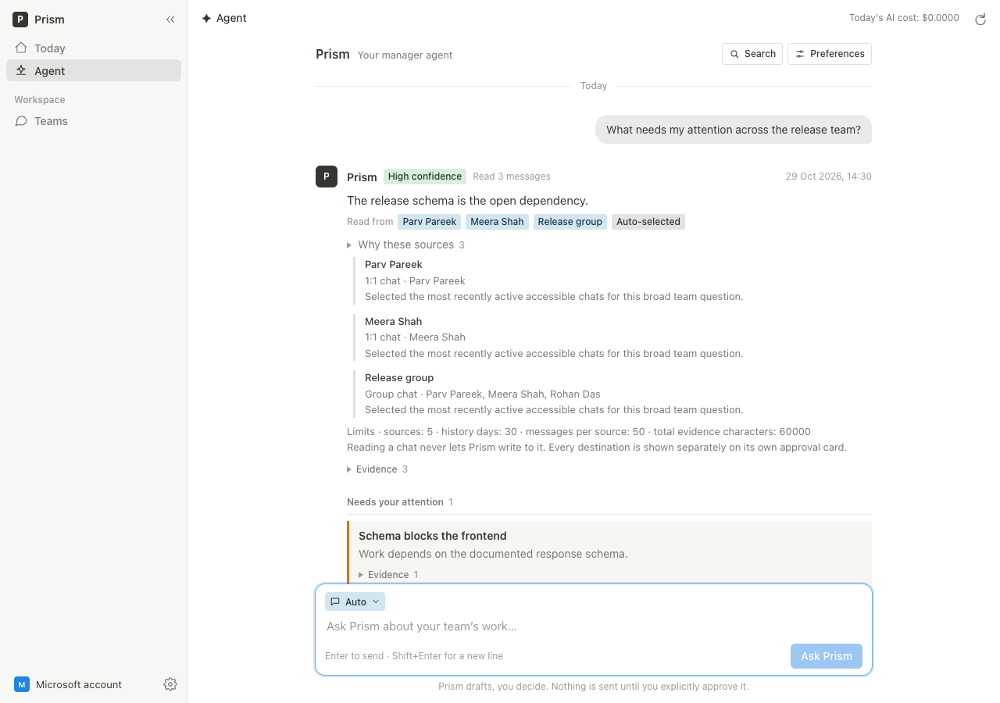
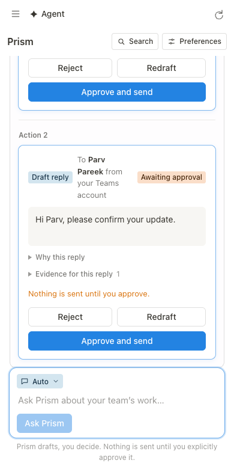
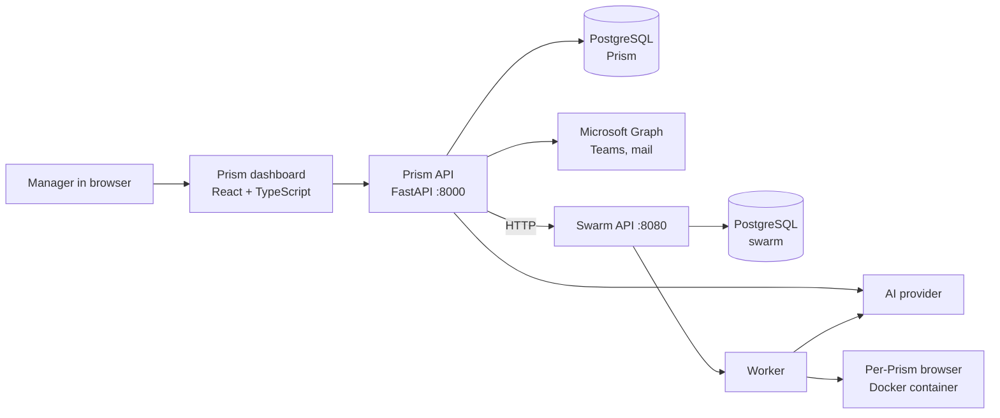

# Prism

Prism is a self-hosted AI team for a manager. You create specialised assistants, called **Prisms** (also called agents), such as a Chief of Staff, a QA analyst, a researcher or a sales assistant. You give them work in a chat. They read your Microsoft Teams conversations, browse the web in their own browser, and prepare updates, reports and drafts. **Nothing leaves your account without your approval.**

> **Status: pre-release.** Prism is under active development and has not had an independent security audit. It is a local, single-user control plane, not a multi-tenant SaaS product. Try it in a non-production Microsoft tenant before pointing it at a real team.

## What it does

**Teams chief of staff.** Ask "What needs my attention across the release team?" in one continuing conversation. Prism picks relevant Teams chats you can access, reads them (read only), and answers with the sources it used. Every claim cites stored messages. It can prepare replies as draft cards. You edit, approve or reject each card, and Prism sends only the exact approved text from your connected Microsoft account.

**Prisms with their own computer.** Each Prism has its own instructions, tool permissions, task limits and a private browser (Chromium in a Docker container). Give it a web task ("Test https://example.com", "Research this topic", "Find 10 leads") and it shows a plan first. When you start it, it browses, records progress, asks you questions, and returns a report or a file (for example a CSV).

**Approvals for anything risky.** Tools are set to **Allowed**, **Ask first** or **Off**. Logging in, using a new website, sending, posting, paying and deleting all wait for your decision. Passwords go through a secure login card and are stored encrypted, not typed into chat.

**A workspace around the chat.**

| Area | What you do there |
| --- | --- |
| Chats | Talk to each Prism; one continuing, searchable conversation per Prism |
| Workspace → Work | Tasks, Runs, Approvals, Bugs |
| Workspace → Team | Prisms as cards or an org chart (Chief of Staff, roles, departments, reporting lines) |
| Workspace → Setup | Target apps, Secrets, Skills |
| Workspace → Overview | Dashboard, Spending, Run analytics |
| Knowledge → Brain | Facts Prisms learned from chats; you approve them before they are shared |
| Settings | Preferences, Notifications, Connections (Microsoft), AI provider, Developer |

**Skills and tools.** Skills are reusable instruction sets for any department. Skills never grant tool access; permissions are set separately.

**Bring your own AI model.** Azure OpenAI, OpenAI, Anthropic (Claude), DeepSeek, any OpenAI-compatible endpoint, or the local Codex CLI. Keys are encrypted at rest.

**Optional daily automation.** Scheduled Teams check-ins, follow-ups and an end-of-day manager brief by email (off by default).

### How safety works

- Prism uses **delegated** Microsoft permissions. Messages and mail are sent visibly from the connected manager account. It is not a bot.
- Teams text, web pages and model output are treated as untrusted data. A deterministic validation layer checks proposed actions and citations before anything changes.
- Outward actions wait for approval. Sends use exact approved text, re-authorisation and idempotency keys, and an unconfirmed send is never retried blindly.
- Secrets stay server side. Logins are masked from events and never enter model context.
- Browser computers resolve traffic through a proxy that blocks private and metadata addresses.





## How it fits together



This is a monorepo with two applications. Prism is the only user interface.

| Path | What it is |
| --- | --- |
| `apps/prism/` | The Prism backend (FastAPI, SQLAlchemy, Alembic, PostgreSQL) and the dashboard in `apps/prism/frontend` (React 19, TypeScript, Vite). The built dashboard is served at `/dashboard/` |
| `apps/swarm/` | The execution engine: agent runtime (OpenAI Agents SDK), browser computers, workers, tools, budgets, events and artifacts. API only, no UI |
| `docs/` | Guides, release runbooks, ADRs and architecture notes |
| `scripts/` | `dev.sh` (starts everything) and `check_secrets.py` |
| `compose.yaml` | Docker Compose for the whole platform |

Prism talks to the swarm only through its HTTP API. Teams access is always mediated by Prism's Graph integration; the swarm reaches Teams through a signed bridge.

## Requirements

| Needed for | Requirement |
| --- | --- |
| Everything | Git, GNU Make, PostgreSQL 14 or newer, Python 3.11 or 3.12, Node.js 22 or newer with npm |
| Web tasks (computers) | [uv](https://docs.astral.sh/uv/), Docker Desktop running on the machine that runs the swarm worker, and an AI provider key |
| Teams features | A Microsoft Entra ID tenant where you can register an application, and an HTTPS URL reachable by Microsoft for webhooks (ngrok works for local testing) |

macOS with Homebrew:

```bash
brew install python@3.11 node postgresql@16 uv ngrok/ngrok/ngrok
brew services start postgresql@16
```

On Linux or Windows (WSL2), install the same packages with your package manager. Docker Compose can replace local Python and PostgreSQL; see [Run with Docker](#run-with-docker).

## Quick start (Prism only)

This gets the dashboard and API running with no Microsoft or AI credentials. Run commands from the repository root.

```bash
git clone https://github.com/oneclarity-ai/prism.git
cd prism

cp apps/prism/.env.example apps/prism/.env
make setup                   # Python venv, Python deps, dashboard deps (npm ci)
```

Create a database and a user:

```bash
createuser --pwprompt prism
createdb --owner=prism prism
```

Edit `apps/prism/.env`. Generate two secrets and paste them in:

```bash
python3 -c "import secrets; print(secrets.token_urlsafe(32))"                                  # OPERATOR_API_TOKEN
python3 -c "from cryptography.fernet import Fernet; print(Fernet.generate_key().decode())"      # MICROSOFT_TOKEN_ENCRYPTION_KEY
```

```dotenv
DATABASE_URL=postgresql+psycopg://prism:<password>@localhost:5432/prism
OPERATOR_API_TOKEN=<first value>
MICROSOFT_TOKEN_ENCRYPTION_KEY=<second value>
APP_ENV=development
INTELLIGENCE_LLM_ENABLED=false
AUTOMATION_SCHEDULER_ENABLED=false
MICROSOFT_WEBHOOK_BASE_URL=
```

Keep both secrets private and stable. Changing the Fernet key later makes stored Microsoft tokens and provider keys unreadable. Never commit `.env`.

Migrate and start:

```bash
make migrate
make dev
```

`make dev` builds the dashboard into `apps/prism/app/static` the first time. Open:

- Dashboard: <http://127.0.0.1:8000/dashboard/>
- API docs: <http://127.0.0.1:8000/docs>
- Health: <http://127.0.0.1:8000/health> and <http://127.0.0.1:8000/health/db>

For hot reload while editing the dashboard, run `make frontend-dev` beside `make dev` and open <http://localhost:5173/dashboard/>.

If the dashboard answers `401`, open **Settings** (profile menu at the bottom of the sidebar), go to the **Developer** section, and enter the exact `OPERATOR_API_TOKEN`. The browser stores it locally and sends it as `X-Manager-Operator-Token`. With `APP_ENV=development` and no webhook URL, the API also works without a token.

## Add AI model access

Pick one provider. You can set it in the dashboard (**Settings → AI provider**, keys stored encrypted) or in `apps/prism/.env`.

```dotenv
INTELLIGENCE_LLM_ENABLED=true
LLM_PROVIDER=azure_openai       # azure_openai | openai | anthropic | deepseek | custom | codex_local
```

| Provider | Variables |
| --- | --- |
| Azure OpenAI | `AZURE_OPENAI_ENDPOINT`, `AZURE_OPENAI_API_KEY`, `AZURE_OPENAI_DEPLOYMENT`, `AZURE_OPENAI_API_VERSION` |
| OpenAI | `OPENAI_API_KEY`, `OPENAI_BASE_URL` |
| Anthropic | `ANTHROPIC_API_KEY`, `ANTHROPIC_BASE_URL` |
| DeepSeek | `DEEPSEEK_API_KEY`, `DEEPSEEK_BASE_URL` |
| Any OpenAI-compatible endpoint | `CUSTOM_LLM_API_KEY` plus its base URL and model, with `LLM_PROVIDER=custom` |

Restart Prism after editing `.env`. `LLM_MODEL_PRICING` is optional and is used only for cost estimates. The swarm has its own model settings (next section).

## Add computers for web tasks (unified workspace)

Prisms that browse the web run on the swarm. Set it up once, then start both projects with one command.

1. **Install and seed the swarm** (needs `uv`, creates its Python environment and database, writes `apps/swarm/backend/.env`):

   ```bash
   make swarm-setup
   ```

2. **Fill `apps/swarm/backend/.env`:**

   ```dotenv
   AZURE_OPENAI_ENDPOINT=https://<resource>.openai.azure.com
   AZURE_OPENAI_API_KEY=<key>
   AZURE_OPENAI_DEPLOYMENT=<deployment>
   PRISM_BRIDGE_URL=http://localhost:8000
   PRISM_BRIDGE_SECRET=<long random value>     # same value as Prism's WORK_BRIDGE_SECRET
   ```

   The swarm creates an admin login on first setup (`SEED_ADMIN_EMAIL` and `SEED_ADMIN_PASSWORD` in its `.env`). Change the default password before using the platform beyond your own machine.

3. **Turn on the matching Prism flags in `apps/prism/.env`:**

   ```dotenv
   PRISM_V21_ENABLED=true     # one manager conversation (Teams review)
   PRISM_V22_ENABLED=true     # multiple Prisms, approvals, spending
   PRISM_V24_ENABLED=true     # Prism computers, Workspace Work/Team pages
   QA_SWARM_URL=http://localhost:8080
   QA_SWARM_EMAIL=<the swarm admin email>
   QA_SWARM_PASSWORD=<the swarm admin password>
   WORK_BRIDGE_SECRET=<same value as PRISM_BRIDGE_SECRET>
   ```

4. **Start Docker Desktop**, then migrate the swarm and Prism and launch everything:

   ```bash
   make migrate                                  # Prism schema
   (cd apps/swarm/backend && uv run alembic upgrade head)
   make dev-all                                  # Prism :8000, swarm API :8080, worker
   ```

   `make dev-all` stops with a clear message if ports 8000 or 8080 are busy. The swarm worker needs Docker to start the per-Prism browser containers (image `mcr.microsoft.com/playwright/mcp`; pin a tag with `COMPUTER_IMAGE` outside local development).

5. **Check it:** open <http://127.0.0.1:8000/dashboard/>, and confirm the Workspace Prisms page loads. Operators can also run `apps/prism/.venv/bin/python apps/prism/scripts/prism_admin.py work-check`, which should print `"ok": true`.

Then create a Prism (**Chats → Create Prism**: name, role, department, who it reports to, what it does), finish onboarding in its chat, and ask it for a task. Review the plan, start it, answer any question it asks, and read the report.

Notes:

- Computers stop by themselves after `COMPUTER_IDLE_MINUTES` (default 10). Browser profiles (logins, cookies) are kept; `prism_admin.py computers reset` clears them.
- Each run is bounded by `WORK_MAX_TURNS_CAP`, `WORK_BUDGET_CAP_USD` and `WORK_MAX_MINUTES`. Do not raise them just to force a task to finish.
- A task on `example.com` stays inside that origin. Other sites, including subdomains, need a separate approval.
- Captchas and one-time codes stop a run. There is no take-control feature yet.

## Connect Microsoft Teams (optional but central to Chief of Staff)

Prism needs an Entra app registration and a public HTTPS callback.

### 1. Register the application

In the [Microsoft Entra admin center](https://entra.microsoft.com/):

1. **Identity → Applications → App registrations → New registration**. Name it (for example `Prism Local`) and choose **single tenant**.
2. Under **Redirect URI**, choose **Web** and add `http://localhost:8000/api/v1/microsoft/auth/callback`.
3. Copy the **Application (client) ID** and **Directory (tenant) ID**.
4. **Certificates & secrets → New client secret**. Copy the **Value** (not the secret ID).
5. **API permissions → Add a permission → Microsoft Graph → Delegated permissions**: `User.Read`, `User.Read.All`, `Chat.Create`, `Chat.Read`, `ChatMessage.Send`, `Mail.Send`. Prism also requests `openid`, `profile` and `offline_access` at sign-in.
6. Select **Grant admin consent** if your tenant requires it.

Add to `apps/prism/.env`:

```dotenv
MICROSOFT_TENANT_ID=<directory-tenant-id>
MICROSOFT_CLIENT_ID=<application-client-id>
MICROSOFT_CLIENT_SECRET=<client-secret-value>
MICROSOFT_REDIRECT_URI=http://localhost:8000/api/v1/microsoft/auth/callback
```

Restart Prism.

### 2. Connect the manager account

In the dashboard open **Settings → Connections** and choose **Connect Microsoft account**. Sign in with the account that should send Teams messages and mail, and accept the permissions. The dashboard then shows the connected name and email. `AADSTS50011` means the Entra redirect URI does not exactly match `MICROSOFT_REDIRECT_URI`.

You can now ask Chief of Staff questions about your Teams chats. Reading is read only and limited to chats you can already access.

### 3. Webhooks, scope and automation (only for live Teams monitoring)

Microsoft must reach Prism over public HTTPS to deliver message notifications:

```bash
ngrok config add-authtoken <token>
ngrok http 8000
```

```dotenv
MICROSOFT_WEBHOOK_BASE_URL=https://example.ngrok-free.app   # origin only, no trailing slash
```

Restart Prism. A configured webhook URL makes the management API require the operator token. If the ngrok URL changes, stop automation, update the variable, restart, and start automation again. Use a stable domain beyond local testing.

For managed daily check-ins, import directory users, add **only** the people Prism may contact to the managed scope, test with one willing person, and then start automation. To schedule it:

```dotenv
AUTOMATION_SCHEDULER_ENABLED=true     # enable in exactly one process
MANAGER_TIMEZONE=Asia/Kolkata
DAILY_CHECKIN_TIME=10:00
DAILY_FOLLOWUP_TIME=13:00
DAILY_DIGEST_TIME=19:30
```

## Run with Docker

```bash
cp apps/prism/.env.example apps/prism/.env
cp apps/swarm/backend/.env.example apps/swarm/backend/.env
echo 'PRISM_DATABASE_PASSWORD=<a long local-only password>' > .env     # read by Compose
docker compose up --build
```

Compose starts Prism's database, applies migrations and starts Prism on port 8000, then starts the swarm database, API (8080) and worker. Prism reaches the swarm at `http://swarm-api:8000` inside Compose. It refuses to start until `PRISM_DATABASE_PASSWORD` is set. Stop with `docker compose down`; add `--volumes` only to delete the data.

## Configuration

Everything comes from environment variables or an ignored `.env` file. The complete, commented list is [apps/prism/.env.example](apps/prism/.env.example) (swarm: [apps/swarm/backend/.env.example](apps/swarm/backend/.env.example)).

| Variable | Purpose | Safe default |
| --- | --- | --- |
| `APP_ENV` | `development` allows unauthenticated local use; anything else requires the operator token | `development` |
| `DATABASE_URL` | PostgreSQL URL (`postgresql+psycopg://...`) | required |
| `OPERATOR_API_TOKEN` | Protects management APIs via `X-Manager-Operator-Token` | required when public |
| `MICROSOFT_*` | Entra OAuth, token encryption key, webhook URL | disabled when blank |
| `LLM_PROVIDER`, `*_API_KEY`, `AZURE_OPENAI_*` | AI provider settings | disabled when blank |
| `PRISM_V21_ENABLED`, `PRISM_V22_ENABLED`, `PRISM_V24_ENABLED` | Teams conversation, multiple Prisms, computers | `false` in the example |
| `QA_SWARM_URL`, `QA_SWARM_EMAIL`, `QA_SWARM_PASSWORD` | Prism's connection to the swarm API | blank |
| `WORK_BRIDGE_SECRET` | Shared secret for the signed Teams bridge (matches the swarm's `PRISM_BRIDGE_SECRET`) | blank |
| `WORK_MAX_TURNS_CAP`, `WORK_BUDGET_CAP_USD`, `WORK_MAX_MINUTES` | Hard ceilings on any computer task | see `.env.example` |
| `AUTOMATION_SCHEDULER_ENABLED`, `DAILY_*_TIME`, `MANAGER_TIMEZONE` | Scheduled daily automation | off |

Health checks, the Microsoft OAuth callback and the Teams webhook are public by design. `/api/v2/bridge/` bypasses operator auth but verifies a timestamped HMAC. The static dashboard is public; the token lives in your browser's local storage.

## Troubleshooting

| Symptom | Likely cause and fix |
| --- | --- |
| Dashboard or API returns `401` | Enter the exact `OPERATOR_API_TOKEN` in **Settings → Developer**. A `503` means a public webhook URL or non-development `APP_ENV` is set with a blank token |
| `make dev` says the dashboard is not built | Run `make frontend-build` (needs Node 22+). A `503` from `/dashboard/` means `app/static` is missing |
| Database errors | Check PostgreSQL is running, the database exists, `DATABASE_URL` is right, and `make migrate` has run |
| Workspace pages empty or "computer service unavailable" | Swarm API or worker is not running, `QA_SWARM_*` is wrong, or `PRISM_V22_ENABLED` / `PRISM_V24_ENABLED` is off. Run `make dev-all` |
| A run fails with "Docker is not available" | Start Docker Desktop on the machine running the swarm worker |
| A run stays at zero steps ("Waiting for workspace") | Check the swarm API and worker. A listening port alone does not prove the API is healthy; restart a stale Uvicorn process |
| `AADSTS50011` | The Entra redirect URI must match `MICROSOFT_REDIRECT_URI` exactly |
| `ERR_NGROK_8012` or connection refused | ngrok is not forwarding to port 8000, or the URL in `MICROSOFT_WEBHOOK_BASE_URL` is stale |
| Replies are not processed | Check the tunnel, that automation is active, and renew the listener |
| Daily email missing | Check `Mail.Send` permission, timezone, `DAILY_DIGEST_TIME`, and that the scheduler runs in exactly one process |
| Browser site blocked (`ERR_BLOCKED_BY_CLIENT`) | The computer allows exact origins only; a site's own API on another host needs a separate approval |

## Development

Run from the repository root (the root `Makefile` forwards to `apps/prism`):

```bash
make check               # lint, format, mypy, tests, secret scan, dashboard checks
make test                # fast tests; database and browser suites are skipped
make test-integration    # PostgreSQL tests (RUN_DB_TESTS=1), disposable database only
make test-e2e            # Playwright browser journeys against a built dashboard
make frontend-check      # tsc, ESLint, Vitest for the dashboard
make frontend-types      # regenerate API types after backend schema changes
make audit               # dependency audit (needs network)
```

Swarm tests: `cd apps/swarm/backend && uv run pytest` (uses a separate `oneclarity_test` database).

Integration tests can modify the database they use. Point them only at a dedicated test database, never one with useful data. Tests fake Graph, AI providers and the swarm, and block live `httpx.post` calls by default. Schema changes need a reviewed Alembic migration with a downgrade. Do not edit a published migration.

## Documentation

- [AGENTS.md](AGENTS.md): conventions, architecture and safety rules for contributors and coding agents
- [ARCHITECTURE.md](ARCHITECTURE.md): components, data flow, security boundaries
- [Monorepo layout](docs/architecture/monorepo.md) and [changes since v2.4](docs/releases/post-v2.4-changes.md)
- Runbooks: [v2.1](docs/releases/v2.1-release-runbook.md), [v2.2](docs/releases/v2.2-release-runbook.md), [v2.4 computers and website testing](docs/releases/v2.4-release-runbook.md)
- Guides: [dashboard navigation](docs/guides/dashboard-navigation.md), [design system](docs/guides/prism-design-system.md), [skills](docs/guides/prism-skills.md), [team organization](docs/guides/prism-team-organization.md)
- [CONTRIBUTING.md](CONTRIBUTING.md), [SECURITY.md](SECURITY.md), [ROADMAP.md](ROADMAP.md), [SUPPORT.md](SUPPORT.md), [CHANGELOG.md](CHANGELOG.md)

## Security

Do not report vulnerabilities in a public issue; follow [SECURITY.md](SECURITY.md). Prism handles employee messages and delegated Microsoft tokens, so use isolated infrastructure, HTTPS, a strong operator token, encrypted backups and a managed secret store beyond local development. Never put keys in the README, issues, screenshots or Git.

## Licence

Prism is licensed under the [MIT License](LICENSE).
