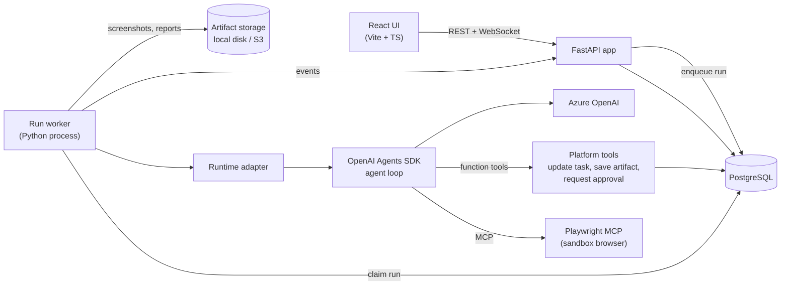
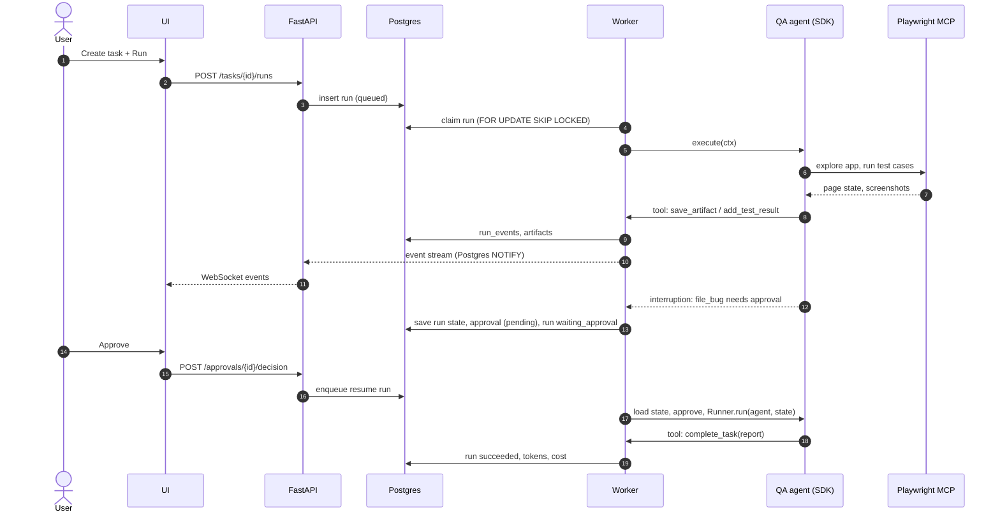

# 02 — Architecture

## Components



- **FastAPI app**: REST API for the UI, WebSocket for live run events, auth, validation.
- **Run worker**: separate process. Claims queued runs from Postgres, executes them through the adapter, writes events, enforces timeouts and budgets.
- **Runtime adapter**: one interface (`execute(run_context) -> RunResult`). The first implementation uses the OpenAI Agents SDK with an Azure OpenAI client.
- **Platform tools**: Python functions exposed to the agent as SDK function tools. They are the only way the agent changes platform state. Risky ones are marked `needs_approval`.
- **Playwright MCP**: browser control (navigate, click, type, screenshot, read console). Runs in a container with no access to secrets other than the test login.
- **Artifact storage**: screenshots, test scripts, reports. Local folder in dev, S3-compatible bucket later.

## Run flow



## Folder structure

```
<project root>/
├── docs/                            # this plan
├── backend/
│   ├── pyproject.toml
│   ├── alembic/                     # migrations
│   └── app/
│       ├── main.py                  # FastAPI app factory
│       ├── core/                    # config, logging, security, deps
│       ├── db/                      # session, base, models/
│       ├── schemas/                 # Pydantic request/response models
│       ├── api/routers/             # agents, targets, tasks, runs, approvals, artifacts, ws
│       ├── services/                # business logic (tasks, runs, approvals, budgets)
│       ├── runtime/
│       │   ├── base.py              # RuntimeAdapter interface, RunContext, RunResult
│       │   ├── openai_agents.py     # OpenAI Agents SDK + Azure OpenAI adapter
│       │   ├── fake.py              # scripted adapter for tests and UI work
│       │   └── claude_sdk.py        # later, optional
│       ├── tools/                   # platform tools exposed to agents
│       ├── skills/qa/SKILL.md       # QA agent instructions
│       └── worker/                  # queue claim loop, run executor, scheduler
├── frontend/
│   ├── package.json
│   └── src/
│       ├── api/                     # generated OpenAPI types + client
│       ├── components/
│       ├── features/                # agents, targets, tasks, runs, approvals
│       ├── pages/
│       └── lib/                     # ws client, utils
├── sandbox/                         # Playwright MCP Dockerfile
├── eval-app/                        # demo app with seeded bugs (see 13)
└── docker-compose.yml
```

## Tech choices

| Area | Choice |
| --- | --- |
| API | FastAPI, Pydantic v2, Uvicorn |
| ORM / migrations | SQLAlchemy 2.0 (async) + Alembic |
| DB driver | asyncpg |
| Queue | `runs` table + `SELECT … FOR UPDATE SKIP LOCKED`; Postgres `LISTEN/NOTIFY` for events |
| Scheduler | APScheduler in the worker for cron-style tasks |
| Agent | `openai-agents` (Python) with `AsyncAzureOpenAI` client |
| LLM | Azure OpenAI deployments |
| Browser | `@playwright/mcp` server + Playwright browsers in a container |
| Logging | structlog (JSON) |
| Tracing (later) | OpenTelemetry + Langfuse |
| Frontend | React 18, TypeScript, Vite, React Router, TanStack Query, Tailwind CSS, shadcn/ui |
| API types | `openapi-typescript` generated from FastAPI's `/openapi.json` |
| Package managers | `uv` (Python), `pnpm` (Node) |
