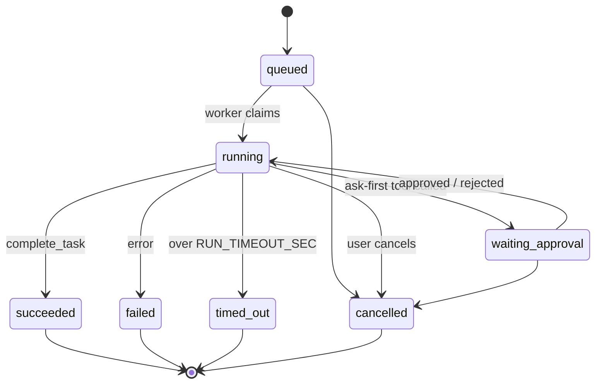

# 08 — Run Orchestration (Queue, Worker, Heartbeats)

Paperclip's key idea, kept here: agents do not run forever. Each **run** is a bounded heartbeat that starts, works, saves state and stops.

## Run lifecycle



## Steps

1. **Enqueue** — `POST /tasks/{id}/runs` inserts a `queued` run. Reject if the agent is paused, over budget, or the task already has an active run (one active run per task = Paperclip's atomic checkout).
2. **Claim** — worker loop every 1–2 s:
   ```sql
   SELECT id FROM runs WHERE status = 'queued'
   ORDER BY created_at FOR UPDATE SKIP LOCKED LIMIT 1;
   ```
   Then set `running`, `started_at`. Allow N concurrent runs per worker (`MAX_CONCURRENT_RUNS`, start with 2).
3. **Build context** — load agent, task, target app, previous run summary and session id; render the run prompt.
4. **Execute** — call the adapter in an `asyncio` task wrapped in `asyncio.wait_for(timeout)`.
5. **Events** — every adapter event → `run_events` row (monotonic `seq`) + `pg_notify`.
6. **Cancel** — `POST /runs/{id}/cancel` sets a `cancel_requested` flag; the adapter checks it and stops; status → `cancelled`.
7. **Finish** — store tokens, cost, session id; write `budget_ledger`; set task status from the result; notify.
8. **Recovery** — on worker start, mark runs stuck in `running` with no event for > timeout as `failed` (reason `worker_restart`) so they can be retried.
9. **Retries** — manual re-run in the MVP; automatic retry only for infrastructure errors (max 1).
10. **Schedules** — APScheduler in the worker reads `tasks.schedule_cron` and enqueues runs (trigger `schedule`). Skip if a run is already active.

## Done when

- Two runs started together execute in parallel; a third waits in `queued`.
- Killing the worker mid-run leaves the run `failed` with a clear reason after restart.
- Cancel stops a run within 10 seconds.
- A nightly schedule creates a run at the set time.
