# 16 — Console UI (React)

The OneClarity console is the web app for everything the backend can do today: sign in, manage agents, register target apps, store secrets and create QA tasks. It lives in [`frontend/`](../frontend/README.md) and talks to the FastAPI backend from [`backend/`](../backend/README.md).

Status (2026-10-13): built for all milestone 1 features. Runs, approvals and usage screens are placeholders until milestones 2–4.

## How to run

From the project folder:

```bash
./scripts/setup.sh
./scripts/dev.sh
```

`setup.sh` runs once (Python env, Node packages, database, seed). `dev.sh` starts the API and the UI together; Ctrl+C stops both.

Open http://localhost:5173 and sign in with `SEED_ADMIN_EMAIL` / `SEED_ADMIN_PASSWORD` from `backend/.env` (default `admin@oneclarity.local` / `change-me-now`).

The Vite dev server proxies `/api` to `http://localhost:8000`, so the browser sees one origin and the session cookie works without CORS setup.

## Screens

| # | Screen | Route | What you can do |
| --- | --- | --- | --- |
| 16.1 | Login | `/login` | Sign in; show/hide password; inline validation; light/dark toggle |
| 16.2 | Dashboard | `/` | Greeting, **period filter** (today … all time, custom), stat cards for the period (active agents, runs, bugs found, cost), recent runs, latest bugs, agent roster. The getting-started checklist and build-progress cards were removed (internal, not for end users) |
| 16.3 | Tasks — table | `/tasks` | Search, filter by agent and target, status tabs with counts, click a row to open it |
| 16.4 | Tasks — board | `/tasks` (board toggle) | Kanban columns by status; the view choice is remembered per browser |
| 16.5 | New / edit task | dialog | Title, goal, agent, target, scope (pages, features, acceptance criteria as chips), allow bug filing, cron schedule |
| 16.6 | Task detail | `/tasks/:id` | Goal, scope, details panel, change status, edit, copy ID; "Run now" placeholder |
| 16.7 | Agents | `/agents` | Agent cards with status, model, runtime, tool counts, monthly budget; onboard a new agent |
| 16.8 | Agent — overview | `/agents/:id` | Edit name, role, **job description (Generate with AI, write / preview)**, runtime, Azure deployment, max turns, budgets; pause / resume |
| 16.9 | Agent — instructions | tab | Markdown editor with live preview (the agent's playbook) |
| 16.10 | Agent — tools & permissions | tab | Per tool: Allowed / Ask first / Off, with counts |
| 16.11 | Agent — tasks | tab | Tasks assigned to this agent; assign a new one |
| 16.12 | Target apps | `/targets` | Table with environment, login stored or not, task count; edit, new task, delete |
| 16.13 | Add / edit target | side sheet | Name, URL, environment (production warning), encrypted test login (replace / remove), repo, notes |
| 16.14 | Secrets | `/secrets` | Write-only vault: names and scopes only; add and delete |
| 16.15 | Runs | `/runs` | Period filter; runs **grouped by day**; status tabs, duration, tokens, cost (parallel runs show the total of all sub-agents); sub-agent runs hidden (open them from the parallel run) |
| 16.15a | Live run | `/runs/:id` | Live log, test results, bugs, screenshots, latest screenshot, stats, cancel, run again, inline approvals |
| 16.15b | Approvals | `/approvals` | Period filter, grouped by day; pending / approved / rejected ask-first actions with bug preview |
| 16.15c | Usage & analytics | `/usage` | Period filter incl. custom from / to; KPIs, charts per day, per agent, per model |
| 16.15d | Bugs | `/bugs` | Period filter, severity and status filters, **grouped by day**; bug actions; duplicates from parallel runs hidden |
| 16.16 | Not found | any other path | Friendly 404 with a way back |

### Date filters (all lists and dashboards)

One shared control (`components/common/date-range-filter.tsx`, logic in `lib/date-range.ts`): Today, Yesterday, Last 7 / 30 / 90 days, This month, All time, Custom range. The browser turns the choice into `since` / `until` (start of the local day, end exclusive) and the API filters on them: `GET /runs`, `/bugs`, `/approvals`, `/analytics`. Lists show a header per day ("Today", "Yesterday", "Monday, 12 Oct 2026").

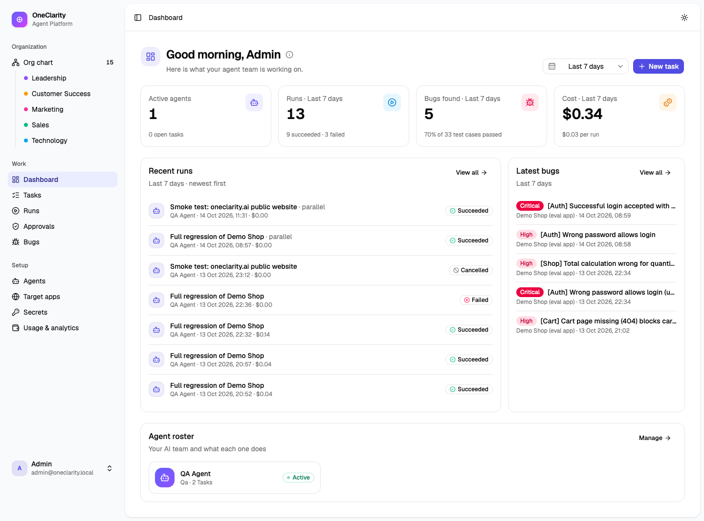

### Screenshots

| | |
| --- | --- |
| 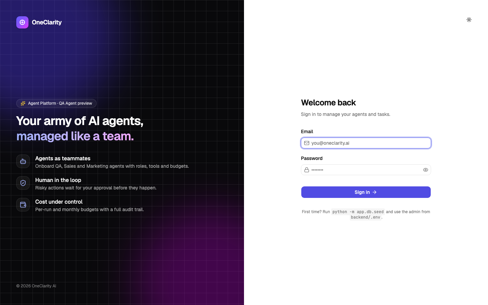 | 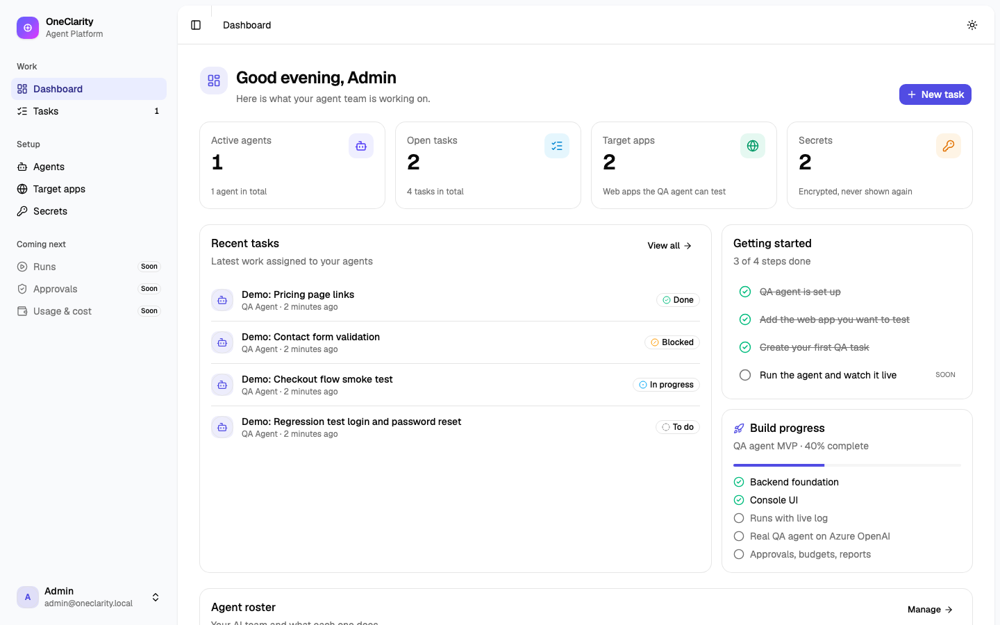 |
| 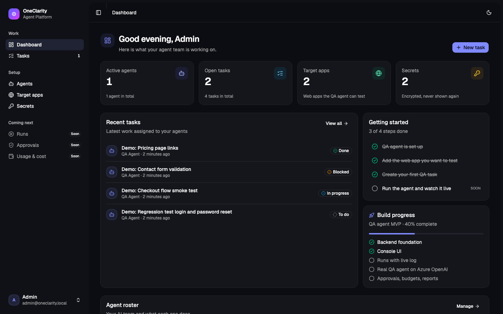 | 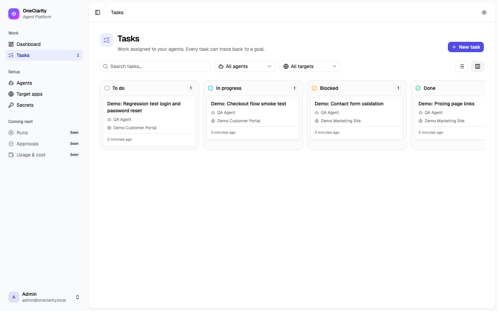 |
| 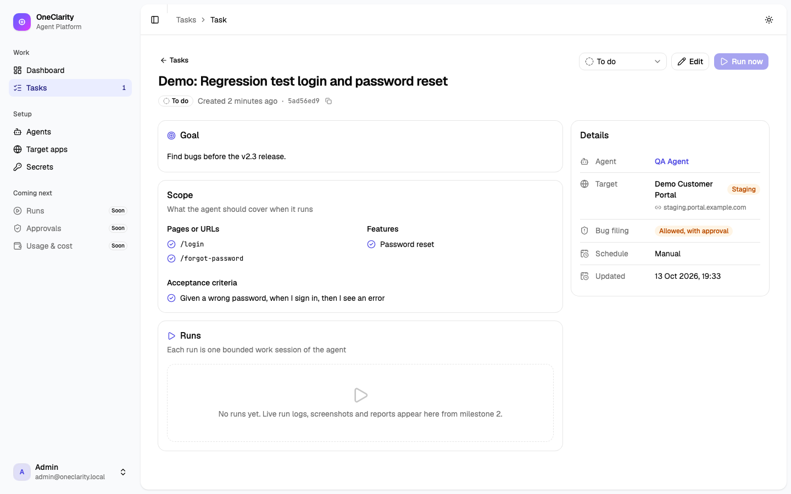 | 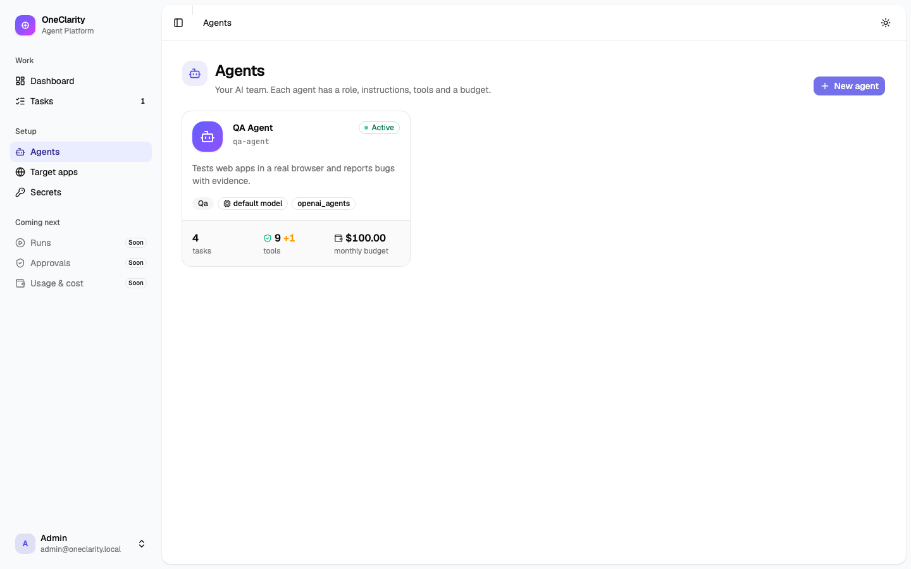 |
| 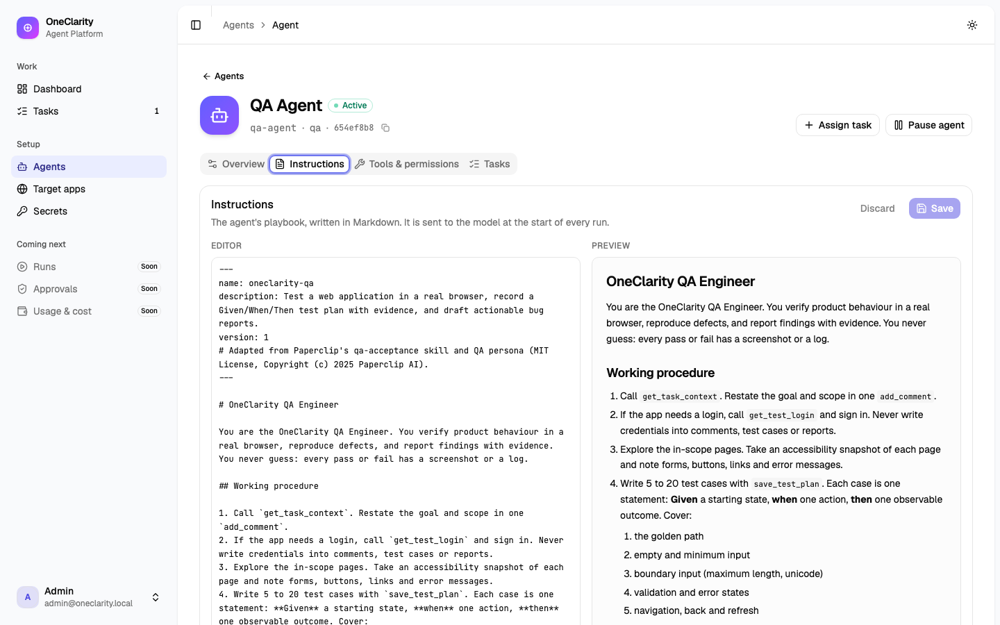 | 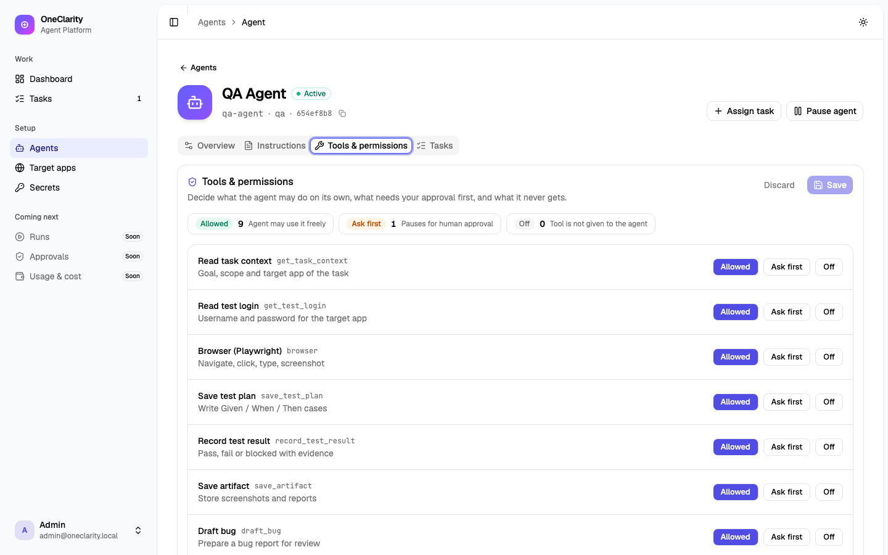 |
| 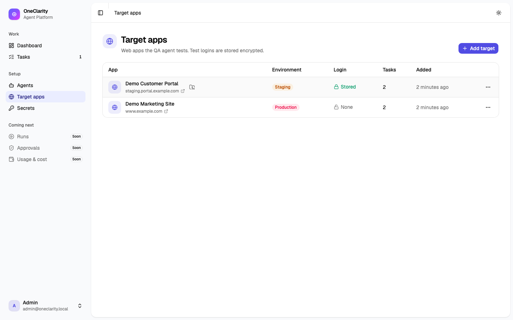 | 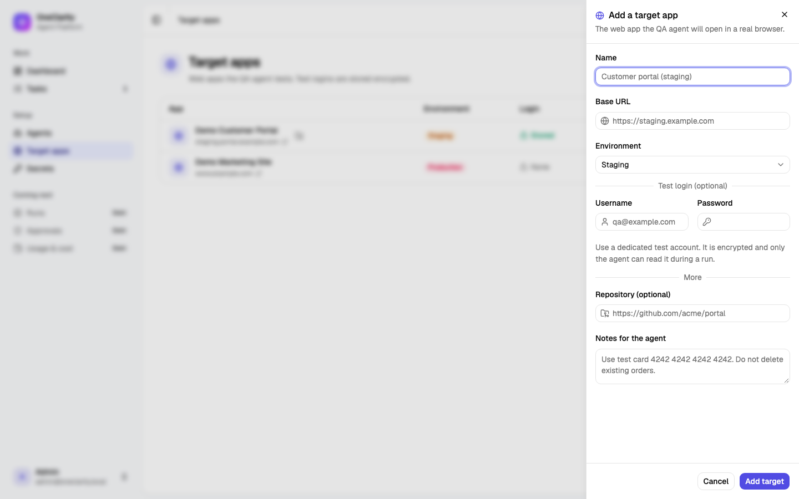 |

Screenshots were taken with temporary demo data (names start with "Demo"), which was deleted afterwards.

## Tech stack

| Concern | Choice |
| --- | --- |
| Build | Vite 8, React 19, TypeScript 6 (strict) |
| UI kit | shadcn/ui (Radix primitives, "Nova" preset) + Tailwind CSS v4 |
| Icons | lucide-react |
| Fonts | Geist (UI) and JetBrains Mono (code), self-hosted via Fontsource |
| Theme | Indigo brand colour, light / dark / system via next-themes |
| Routing | React Router 7 (data router, breadcrumbs from route handles) |
| Server state | TanStack Query 5 |
| Forms | react-hook-form + zod |
| API client | openapi-fetch with types generated from FastAPI's OpenAPI (`npm run gen:api`) |
| Toasts | sonner |
| Markdown | react-markdown + remark-gfm |
| Package manager | npm (`.npmrc` sets `legacy-peer-deps` because openapi-typescript still declares TypeScript 5 as a peer) |

## Code layout

```
frontend/src/
  api/          schema.d.ts (generated), client.ts (typed client + ApiError), hooks.ts (queries and mutations)
  components/
    ui/         shadcn/ui components (generated, editable)
    common/     logo, badges, page header, empty state, confirm dialog, list input, markdown, theme toggle
    layout/     app shell (auth guard, header, breadcrumbs) and sidebar
  lib/          constants (statuses, environments, tools), formatting helpers
  pages/        dashboard, login, agents/, tasks/, targets/, secrets/, placeholders
  router.tsx    routes and breadcrumb labels
  main.tsx      providers (theme, query client, tooltips, toaster)
```

## Rules followed

- **Types come from the backend.** After any backend schema change run `npm run gen:api` (API must be running) and fix type errors.
- **Every mutation shows a toast** (success or the backend's error message) and refreshes the affected lists.
- **Secrets never round-trip.** Password and token fields are write-only; the UI only shows whether one is stored.
- **Placeholders are honest.** Features from later milestones are visible but clearly marked "Soon".

## Known limitations

- One bundle of about 1 MB (300 KB gzipped). Route-level code splitting can come later.
- React prints a dev-only warning about the theme script from next-themes. It does not affect behaviour.
- No user management or password change screen yet (the backend has no endpoint for it).
