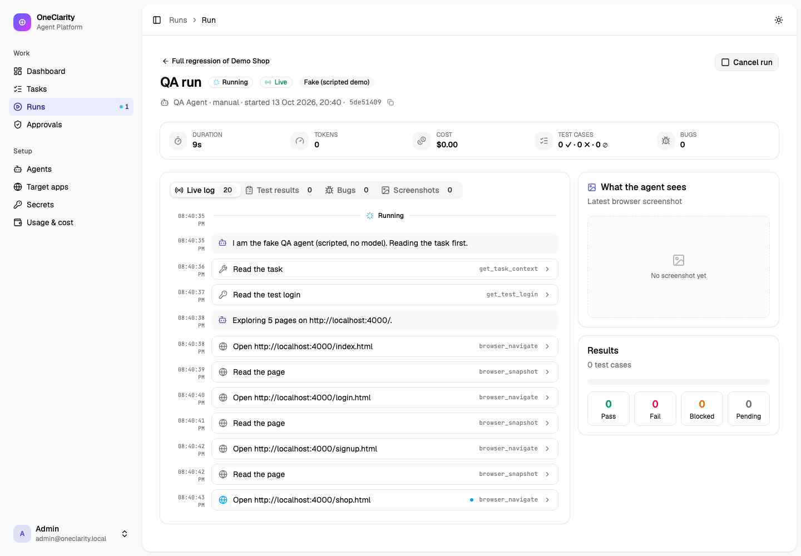
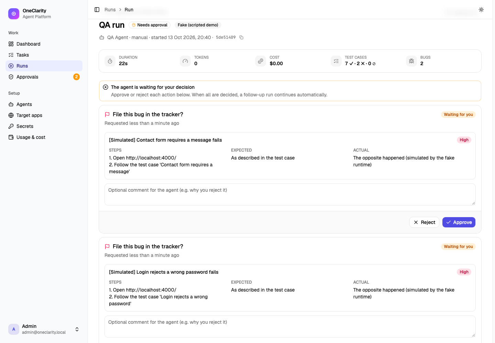
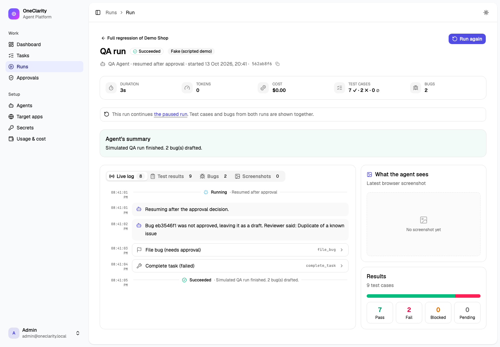

# 20 — Watching the QA Agent Live

How to start the QA agent from the console, what you see while it works, and how to switch from the scripted demo to the real AI agent on Azure OpenAI.

## 20.1 Start everything

```bash
./scripts/setup.sh     # once (or again after pulling changes: it also seeds the Demo Shop task)
./scripts/dev.sh       # every time
```

`dev.sh` now starts four things. All four must run:

| Service | Address | Why |
| --- | --- | --- |
| API | http://localhost:8000/docs | Console and agents talk to it |
| UI | http://localhost:5173 | The console |
| Worker | (no address) | Picks up runs and executes the agent. **Without it, runs stay "Queued".** |
| Demo Shop | http://localhost:4000 | A practice web app with 6 known bugs for the agent to find |

## 20.2 Try it in 1 minute (no Azure needed)

1. Open http://localhost:5173 and sign in.
2. Go to **Agents → QA Agent → Overview** and check **Agent runtime**:
   - **Fake: scripted demo, no AI**: a scripted agent. Works without Azure. Uses the real tools, so test cases, bugs and approvals are real records.
   - **OpenAI Agents SDK · Azure**: the real agent (see 20.4).
3. Go to **Tasks → Full regression of Demo Shop** and press **Run now**.
4. You land on the **live run page**:
   - **Live log**: every step as it happens (reading the task, opening pages, saving the test plan, recording results, drafting bugs).
   - **Test results**, **Bugs**, **Screenshots**: fill in while the agent works.
   - **What the agent sees**: the latest browser screenshot (real agent only).
   - Top bar: duration, tokens, cost, pass / fail counts, **Cancel run**.
5. When the agent wants to **file a bug**, it stops and asks you (status **Needs approval**, orange badge on **Approvals** in the sidebar). Approve or reject each bug, optionally with a comment.
6. After the last decision, a **follow-up run** starts automatically and the page jumps to it. It files the approved bugs, leaves rejected ones as drafts, and finishes with a summary.





## 20.3 What "filing a bug" does today

- If the target app has a **GitHub repository URL** and you stored a secret named **`github-token`** (Secrets page), an approved bug becomes a real GitHub issue with labels `qa-agent` and the severity.
- Otherwise the bug is marked **approved** inside OneClarity only. The Demo Shop has no repository, so this is what you will see.

## 20.4 Switch to the real AI agent (Azure OpenAI)

1. In the Azure portal, open your Azure OpenAI resource and note:
   - **Endpoint**, e.g. `https://my-resource.openai.azure.com`
   - **Key** (Keys and Endpoint page)
   - **Deployment name** of a chat model that supports tool calling. Tested: `gpt-5-nano` runs end to end for about $0.04 per Demo Shop run but misses most bugs and can invent problems (see 19 J-08). Use `gpt-5-mini`, `gpt-4.1` or `gpt-5` for useful results.
   - **API version** enabled for that deployment, e.g. `2024-10-21` or newer
2. Put them in `backend/.env`:
   ```
   AZURE_OPENAI_ENDPOINT=https://my-resource.openai.azure.com
   AZURE_OPENAI_API_KEY=...
   AZURE_OPENAI_API_VERSION=2024-10-21
   AZURE_OPENAI_DEPLOYMENT=my-gpt-deployment
   AZURE_PRICE_INPUT_PER_1M=2.50     # your deployment's real price, for cost estimates
   AZURE_PRICE_OUTPUT_PER_1M=10.00
   ```
3. Check the connection: `cd backend && uv run python scripts/check_azure.py` should print a short reply and token counts.
4. Restart `./scripts/dev.sh` (the worker reads `.env` at start).
5. In the console: **Agents → QA Agent → Overview → Agent runtime → OpenAI Agents SDK · Azure → Save**. The **Usage & cost** page shows "Azure OpenAI connected".
6. Run the Demo Shop task again. Now the agent really opens Chrome (headless), reads pages, logs in with the test account, fills forms, takes screenshots and decides pass / fail itself.

What to expect from a real run on the Demo Shop (rough estimate, not yet measured with a real model):

- A few minutes and several dozen model turns.
- Cost depends on your model and prices; the per-run budget (default $3) stops the run if exceeded. Change it under **Agents → QA Agent → Limits**.
- The 6 seeded bugs are listed in `eval-app/BUGS.md`. Compare what the agent found with that list to judge quality.

To watch the browser window instead of headless, set `BROWSER_HEADLESS=false` in `backend/.env` and restart.

## 20.5 Troubleshooting

| You see | Cause | Fix |
| --- | --- | --- |
| Run stays **Queued** | Worker not running | Use `./scripts/dev.sh`, or run `cd backend && uv run python -m app.worker.main` |
| "Azure OpenAI is not configured…" when pressing Run now | Agent runtime is Azure but `.env` is empty | Fill the values (20.4) or switch the runtime to Fake |
| "This task already has an active run" | A run is queued, running or waiting for approval | Open it from the task page (Watch live run) or cancel it |
| "… has used its monthly budget" | Monthly budget reached | Raise it in Agents → Limits |
| Run **Failed** with "exceeded the per-run budget" | Run cost above the per-run budget | Raise the per-run budget or narrow the task scope |
| Run **Failed** with "Stopped after N turns" | Max turns reached | Raise max turns or narrow the scope |
| Browser step errors mentioning `npx` | Node.js missing for the browser tool | Install Node.js 20+ |
| Live log stops updating | Connection dropped | It reconnects in 2 s; reload the page if not |

## 20.6 Where things live in the code

| Piece | File |
| --- | --- |
| Real agent (OpenAI Agents SDK + Azure + browser) | `backend/app/runtime/openai_agents.py` |
| Scripted demo agent | `backend/app/runtime/fake.py` |
| Tools the agent can use (test plan, results, bugs, login…) | `backend/app/runtime/tools.py` |
| Adapter contract | `backend/app/runtime/base.py`, `registry.py` |
| Worker (claims and runs jobs) | `backend/app/worker/main.py`, `executor.py` |
| Start / cancel / approvals / usage logic | `backend/app/services/runs.py` |
| API incl. live stream `GET /runs/{id}/stream` | `backend/app/api/routers/runs.py` |
| QA agent instructions | `backend/app/agents/qa/SKILL.md` (copied into the agent on seed; edit live under Agents → Instructions) |
| Live run page | `frontend/src/pages/runs/run-detail-page.tsx` |
| Live stream hook | `frontend/src/lib/use-run-stream.ts` |
| Approvals inbox / Runs list / Usage | `frontend/src/pages/runs/` |
| Practice app + answer key | `eval-app/site/`, `eval-app/BUGS.md` |
