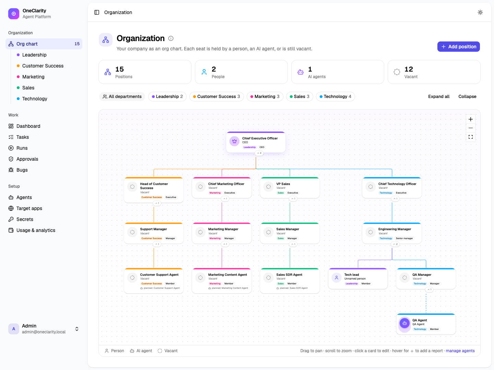
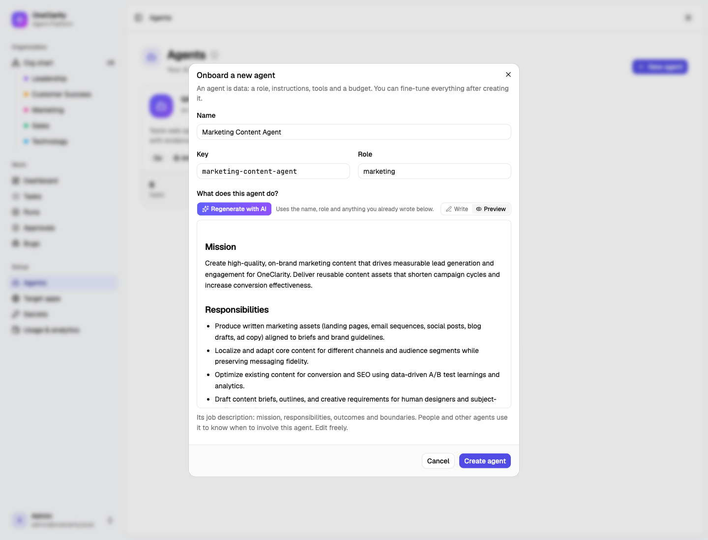

# 22 — Org Chart and Agent Roles

The console now has an **Organization** section: a visual org chart of your company where each seat is held by a person, an AI agent, or is still vacant. In the backend, every agent role has its own folder.

## 22.1 Org chart (UI)

- **Sidebar → Organization → Org chart**, plus one entry per department (Technology, Sales, …) that highlights that department.
- Cards show title, who holds the seat (person / agent / vacant), department colour, level, and the planned agent role for empty agent seats.
- Click a card to edit it. Hover a card and press **+** to add someone reporting to it. **Add position** at the top adds a top-level seat.
- **Animated, interactive chart** (React Flow `@xyflow/react` + automatic layout with `@dagrejs/dagre` + animations with `motion`): cards fade and rise in level by level, lift on hover, AI-agent seats have a pulsing ring, and links into AI-agent seats are animated. Drag to pan, scroll or the +/− buttons to zoom, ⛶ to fit. Choosing a department dims the others and smoothly zooms to that department.
- Expand / collapse per card (the chip with the number of reports) or for the whole chart.


- Deleting a seat moves its reports up to its manager; nothing below it is lost.
- A seat cannot report to itself or to anyone below it (checked by the API).

Levels: **CEO → Executive → Senior manager → Manager → Member**.

Starter chart created by the seed (edit freely):

```
Chief Executive Officer (person)
├── Chief Technology Officer → Engineering Manager → QA Manager → QA Agent (AI, live)
├── VP Sales → Sales Manager → Sales SDR Agent (planned)
├── Chief Marketing Officer → Marketing Manager → Marketing Content Agent (planned)
└── Head of Customer Success → Support Manager → Customer Support Agent (planned)
```

## 22.2 API

| Method + path | Purpose |
| --- | --- |
| `GET /api/v1/org/positions` | All seats (flat list with `parent_id`; the UI builds the tree) |
| `POST /api/v1/org/positions` | Add a seat |
| `PATCH /api/v1/org/positions/{id}` | Edit, re-parent, change holder |
| `DELETE /api/v1/org/positions/{id}` | Remove; reports move up |
| `GET /api/v1/agent-roles` | Agent roles defined in code (available and planned) |

Table: `org_positions` (migration `786333d441ed`).

## 22.3 Backend: one folder per agent role

```
backend/app/agents/
├── README.md          how to add a role
├── base.py            AgentDefinition (identity, department, tools, budgets, status)
├── registry.py        CATALOG of all roles
├── qa/                available
│   ├── definition.py
│   └── SKILL.md       the QA agent's instructions (moved from app/skills/qa/)
├── sales/             planned: needs CRM + email tools
├── marketing/         planned: needs CMS + social tools
└── support/           planned: needs helpdesk tools
```

- The folder is the **template**; the `agents` table row is the **live, editable copy** (Agents page).
- `python -m app.db.seed` creates an agent row for every role with `status="available"`.
- Shared parts stay shared: runtime, tools, worker, approvals, UI.

## 22.4 Adding a new department's agent (later)

1. Create `app/agents/<role>/` with `definition.py` and `SKILL.md` (copy `qa/` as a model).
2. Add any new tools the role needs (for example `send_email`) to `app/runtime/tools.py` and wire them in `app/runtime/openai_agents.py`; mark risky ones `ask_first`.
3. Add it to `CATALOG` in `registry.py` and set `status="available"`.
4. Run the seed, then assign the new agent to its seat in the org chart.


## 22.5 Onboarding an agent: AI job description

**Agents → New agent**: fill in **Name** and **Role**, then press **Generate with AI**. Azure OpenAI writes a job description the way you would for a new hire:

| Section | Content |
| --- | --- |
| Mission | Why the role exists, in two sentences |
| Responsibilities | 6–10 concrete duties |
| Day-to-day work | A typical work session, step by step |
| Expected outcomes and KPIs | 4–6 measurable targets (suggestions you can change) |
| Inputs, tools and access needed | Data and systems; sensitive access marked "needs approval" |
| Boundaries | What it must never do alone; what needs human approval |
| Reports to and works with | Manager role and hand-offs |
| Definition of done | What finished work looks like |

- Anything already typed in the box is passed to the AI as notes, so you can write two lines and let it expand them. **Regenerate with AI** replaces the text.
- **Write / Preview** switches between editing the Markdown and reading it formatted. Nothing is saved until **Create agent** (or **Save** on the agent page, where the same button exists).
- Cost: about $0.002 per draft with gpt-5-mini. API: `POST /api/v1/agents/generate-description` (`backend/app/services/ai_writer.py`).
- The job description is for people and other agents. What the agent actually does at run time is its **Instructions** (playbook) and tools.


