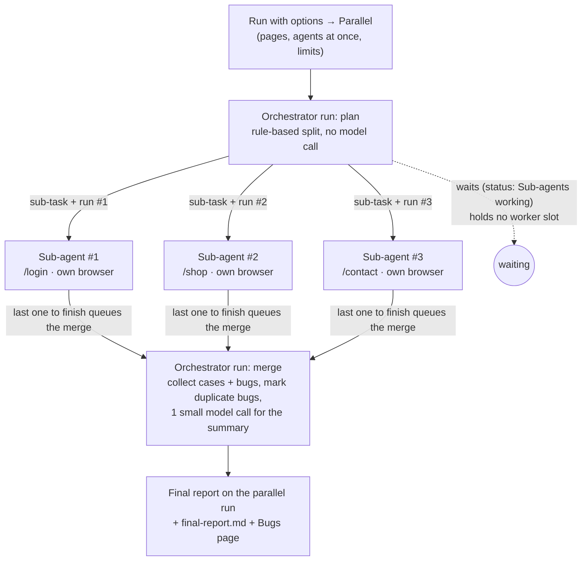
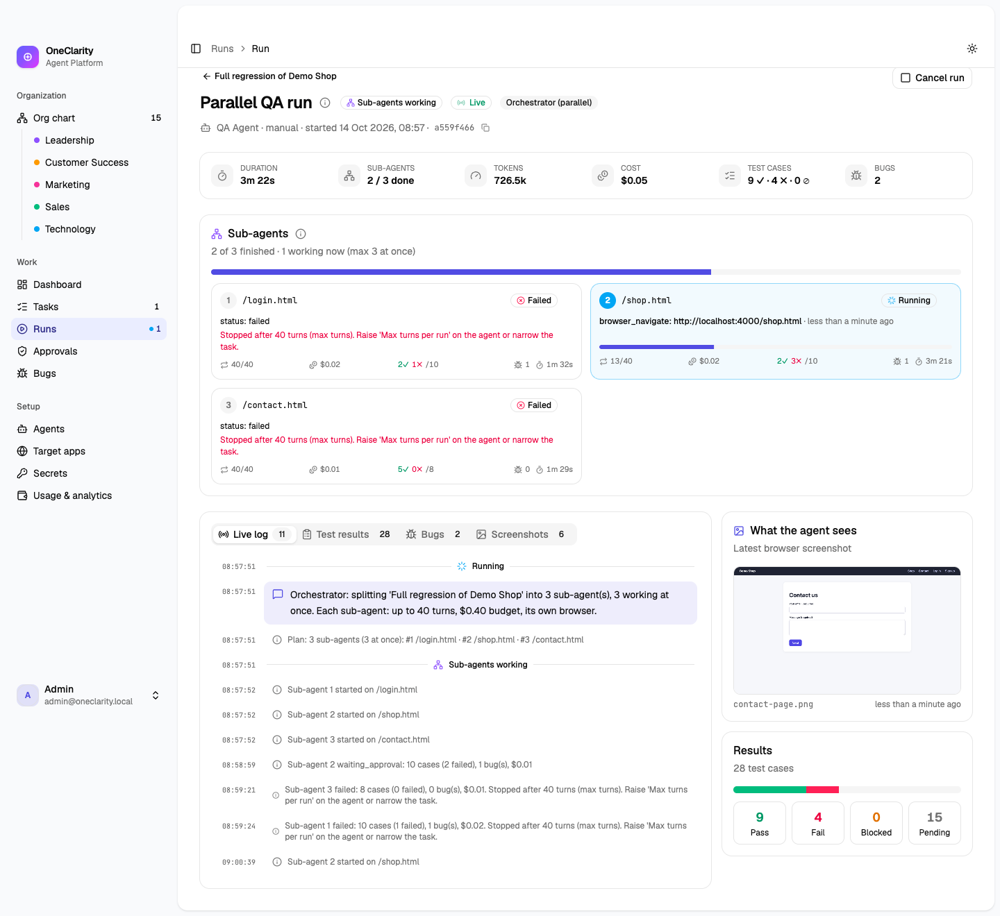

# 26 — Parallel QA Agents with an Orchestrator

Status: **built** (2026-10-14). A task can run with one agent (sequential) or be split over several sub-agents that work at the same time, with one merged final report.

## 26.1 One agent or parallel?

| | One agent | Parallel agents |
| --- | --- | --- |
| How | One browser, one step at a time, all pages | An orchestrator splits the pages; each sub-agent tests its pages in its own browser |
| Best for | 1–3 pages | 4+ pages, or a quick full smoke test |
| Context per agent | Grows with every page | Stays small (1–2 pages each) |
| Result | One run with its summary | One parallel run with a lane per sub-agent and a **final report** |
| Start | Task → **Run now** (all pages) or **Run with options** | Task → **Run with options** → **Parallel agents** |

## 26.2 How it works

1. **Plan.** The worker picks up the orchestrator run. It splits the chosen pages into groups (`pages per agent`, default 1; never more than 12 sub-agents, groups grow instead). A task without pages is split by feature, then by acceptance criterion. For each group it creates (or re-uses) a **sub-task** under the task and queues a **sub-agent run**. Then it waits in status **Sub-agents working**.
2. **Fan out.** Sub-agent runs are normal QA runs: same tools, own browser, own small context. Each gets a `focus` instruction ("you are sub-agent 2 of 4, test ONLY /pricing; others test the rest"), its own max turns and budget. The worker starts at most **agents at once** of them; the others wait in the queue.
3. **Live view.** The parallel run page shows one lane per sub-agent: pages, status, what it is doing right now (e.g. `browser_click: Book a demo`), turns used, cost, test cases ✓/✗, bugs. Its live log shows "Sub-agent 2 started / finished". Click a lane to watch that sub-agent's own live log.
4. **Merge.** When the last sub-agent ends (finished, failed, cancelled), it queues the orchestrator again. The merge collects every test case and bug, marks bugs that two sub-agents reported as **Duplicate** (same title words), and writes the final report: verdict, a table per sub-agent, unique bugs by severity, failed / blocked cases, sub-agents that did not finish, notes from each sub-agent, total cost. For agents on Azure it adds a short executive summary (one small model call). The report is shown on the run page and saved as `final-report.md` with the run's files.
5. **Approvals** still work per sub-agent. A sub-agent that waits for approval keeps the parallel run waiting; after your decision its follow-up run belongs to the same parallel run.
6. **Cancel** on the parallel run stops all sub-agents.

### First live result (Demo Shop, 2026-10-14, gpt-5-mini)

3 sub-agents (`/login.html`, `/shop.html`, `/contact.html`), 3 at once, 40 turns and $0.40 each:

| | Result |
| --- | --- |
| Wall-clock | ~4 min including one approval |
| Test cases | 28 (11 pass, 4 fail, 1 blocked, rest not reached) |
| Real bugs found | 3 of the 6 planted bugs: wrong password accepted, wrong total for quantity 12, empty quantity places an order |
| Cost | **$0.05** in total (sub-agents $0.05, merge $0.001) |
| Learned | 40 turns was too few for 10 cases per page: the agent clicked each field before typing. Added a "one `browser_fill_form` per form" rule and raised the sub-agent default to 80 turns. The duplicate check missed "Successful login accepted with wrong password" vs "Wrong password allows login"; the rule now compares shared words against the shorter title. |

## 26.3 Options (Run with options dialog)

| Option | Meaning | Default |
| --- | --- | --- |
| Pages to test | Tick / untick task pages, or add a page just for this run | all task pages |
| Agents at once | Sub-agents running at the same time (1–8) | 3 |
| Pages per agent | Pages in each sub-agent's group | 1 |
| Max turns per agent | Turn limit of each sub-agent | 80 (`SUBAGENT_MAX_TURNS`) |
| Budget per agent ($) | Cost limit of each sub-agent | $1 (`SUBAGENT_BUDGET_USD`) |

The dialog shows the split before you start (`#1 /login · #2 /pricing …`) and the worst-case cost (agents × budget).

API: `POST /api/v1/tasks/{id}/runs` with body `{"mode": "parallel", "pages": [...], "max_parallel": 3, "pages_per_agent": 1, "max_turns": 60, "budget_usd": 1}`. Lanes: `GET /api/v1/runs/{id}/subagents`.

## 26.4 Limits to respect

- **Two caps.** `Agents at once` limits one parallel run. `MAX_CONCURRENT_RUNS` (default now **4**) limits the whole worker, across all runs. Each running agent opens a Chrome; 4–6 is fine on a laptop.
- **Azure rate limits.** Sub-agents share the deployment's tokens-per-minute quota. HTTP 429 answers are retried with backoff (`AZURE_MAX_RETRIES=6`). If runs still fail with rate-limit errors, lower `Agents at once` or raise the quota in Azure AI Foundry.
- **Shared test accounts.** Sub-agents that log in with the same account at the same time can log each other out. Keep login pages in one group or use separate accounts.
- **Budgets.** Worst case = sub-agents × budget per agent + a few cents for the merge. The monthly agent budget still applies.

## 26.5 Data model

| Column | Meaning |
| --- | --- |
| `runs.kind` | `single`, `orchestrator` (the parallel run) or `child` (a sub-agent run) |
| `runs.parent_run_id` | Sub-agent run → its parallel run |
| `runs.options` | Per-run choices: `pages`, `max_turns`, `budget_usd`; parallel: `max_parallel`, `pages_per_agent`, `phase` (plan / merge), sub-agent `index`, `label` |
| `run status waiting_children` | Parallel run waiting for its sub-agents |
| `tasks.parent_id` | Sub-task → task (existed already). Sub-tasks are hidden from the Tasks list and shown on the parent task |
| `tasks.scope.focus` | Extra instruction for a sub-task |
| `bug_drafts.duplicate_of_id` | Set by the merge when another sub-agent reported the same bug. Bugs page hides duplicates |

Migration `08aad14daed8`.

## 26.6 Code

| File | Role |
| --- | --- |
| `backend/app/worker/orchestrator.py` | `split_scope`, `plan`, `merge`, `find_duplicates`, executive summary |
| `backend/app/worker/executor.py` | Dispatches orchestrator runs; per-run pages / limits; `claim_next` respects `max_parallel`; sub-agent start / finish mirrored into the parent's log; triggers the merge |
| `backend/app/services/runs.py` | `start_run` options, cancel cascade, `maybe_queue_merge`, `append_event` (locked sequence numbers for a log several sub-agents write to) |
| `backend/app/api/routers/runs.py` | `RunStart` body, `/runs/{id}/subagents`, stream stays open while sub-agents work |
| `frontend/src/components/runs/run-dialog.tsx` | Run with options dialog |
| `frontend/src/components/runs/subagents-panel.tsx` | Sub-agent lanes |
| `backend/tests/test_parallel.py` | Split, duplicates, end-to-end with a cap of 2, single-page run, cancel |

## 26.7 Later

- LLM planner (split by user flow instead of by page).
- Manager agents assigning work along the org chart ([22](22-org-chart-and-agent-roles.md)).
- Per-deployment rate limiter shared by all runs (today: per parallel run cap + retries).
