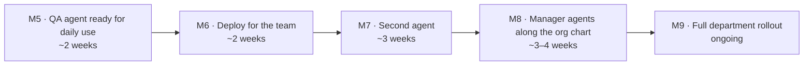

# 28 — Roadmap: What to Build Next (from 2026-10-14)

Where we are, what comes next, in which order, and what each milestone needs from the business. Estimates assume one developer working with Claude Code; adjust as needed.

## 28.1 Where we are today

| Area | Status |
| --- | --- |
| Control plane (agents as data, tasks, runs, approvals, budgets, org chart) | Built |
| QA agent on Azure OpenAI (gpt-5-mini) with a real browser | Built, tested on the Demo Shop and oneclarity.ai |
| Live run view, parallel sub-agents, final report | Built |
| Cost controls (low reasoning, trimming, caching): ~$0.0004 per step | Built |
| Analytics, date filters, bugs page, AI job descriptions, animated org chart | Built |
| Runs start only when someone presses Run | Gap |
| Bug actions (email / Jira / manager) are placeholders | Gap |
| Runs only on a laptop (`./scripts/dev.sh`), single admin user | Gap |
| Only one real agent (QA) | Gap |

## 28.2 Milestones

### M5 · QA agent ready for daily use (~2 weeks)

Goal: the QA agent runs by itself, its bugs reach developers, and repeat runs get cheaper.

| # | Feature | Why | Size |
| --- | --- | --- | --- |
| F-044 | **Scheduled runs** (nightly / weekly per task, cron already stored on the task) | Testing without anyone pressing Run | M |
| F-045 | **Jira integration**: "Raise Jira ticket" creates the issue (project, type, priority from severity, screenshots attached) | Bugs reach the dev team's tool | M |
| F-079 | **Email developer / Send to manager**: real emails with the bug, steps and screenshots (SMTP or Microsoft Graph) | Replace the "coming soon" buttons | S |
| F-080 | **Saved test suites**: keep approved test cases per task and re-run the same suite (regression); the agent only explores when asked | Stable results, fewer turns, lower cost | M |
| F-081 | **Notifications**: Slack / Teams / email when a run fails, a bug is found or an approval waits | People react without watching the console | S |
| F-082 | **Export report** as PDF / Markdown / CSV (run and parallel final report) | Share with managers and clients | S |
| F-048 | **Eval score**: automatic score of a run against the Demo Shop's known bugs; track per model and per prompt change | Know if a change made the agent better or worse | S |

**Exit:** a nightly parallel run on staging, bugs land in Jira after approval, the team gets a morning summary.

### M6 · Deploy for the team (~2 weeks)

Goal: runs 24/7 on a server, several people use it safely.

| # | Feature | Why | Size |
| --- | --- | --- | --- |
| F-083 | **Users and roles**: invite users; Admin / Manager / Viewer; who can approve, run, change agents | Today there is one admin login | M |
| F-084 | **Audit log**: who approved, changed an agent, ran what | Accountability | S |
| F-085 | **Docker + Azure deploy**: API, worker and UI as containers (Azure Container Apps), Azure Database for PostgreSQL, Playwright in the worker image | Runs without a laptop | M |
| F-086 | **Secrets in Azure Key Vault**, HTTPS, CORS and cookie settings for production | Security | S |
| F-047 | **Tracing** (OpenTelemetry / Langfuse) of every model and tool call | Debug and cost analysis at scale | S |
| F-087 | **Shared rate limiter** per Azure deployment across all runs, plus queue priorities | Many parallel runs without 429 errors | S |
| F-088 | **CI**: tests + build on every change (GitHub Actions) | Safe changes | S |
| F-089 | **SSO** with Microsoft Entra ID (optional) | Company login | M |

**Exit:** the console runs at an internal URL, the worker runs 24/7, 3+ people use it with their own logins.

### M7 · Second agent (~3 weeks)

Goal: prove the "army" idea: a new role is mostly data plus a few tools, not a new platform.

Pick one (decision needed, see 28.4):

| Option | What it does | Tools / connectors it needs | Approval gates |
| --- | --- | --- | --- |
| **Customer Support agent** | Drafts answers to tickets from docs and past tickets; tags and routes | Helpdesk (Zendesk / Freshdesk / HubSpot), knowledge base search | Sending any reply |
| **Marketing Content agent** | Drafts blog posts, LinkedIn posts, emails from briefs; checks brand rules | Brand guide, website content, CMS / social scheduler | Publishing anything |
| **Sales SDR agent** | Researches leads, drafts personalised outreach, updates CRM | CRM (HubSpot / Salesforce), web research, email | Sending any email, changing CRM stages |

Platform work this needs (shared by every future agent):

| # | Feature | Size |
| --- | --- | --- |
| F-090 | **Connector framework**: a connector = credentials (secret) + a set of tools + per-tool grants; first connector for the chosen agent | M |
| F-091 | **Knowledge base**: upload documents / URLs per agent, searched as a tool (Azure AI Search or Postgres pgvector) | M |
| F-092 | **Generic run view** for non-browser agents (drafts, outputs, approvals instead of test cases) | M |
| F-093 | **Draft → approve → send** flow reused from QA approvals | S |

**Exit:** the second agent does real work for one team for a week, every external action approved by a person.

### M8 · Manager agents along the org chart (~3–4 weeks)

Goal: work flows down the org chart instead of a person starting every task.

| # | Feature | Size |
| --- | --- | --- |
| F-094 | **Goals → tasks**: a manager (person or agent) sets a goal; a manager agent splits it into tasks for its reports | L |
| F-095 | **QA Manager agent**: plans the weekly test cycle, assigns tasks to QA agents, reviews their reports, escalates critical bugs | M |
| F-096 | **Hand-offs between agents**: e.g. QA bug → Support agent drafts a customer note; Sales feedback → Marketing brief | M |
| F-097 | **LLM planner for parallel runs** (split by user flow, not only by page) | S |
| F-098 | **Department dashboards** and weekly reports per department | M |

**Exit:** a person sets "Release 2.3 tested by Friday"; the QA Manager agent plans, runs and reports, asking humans only for approvals.

### M9 · Full department rollout (ongoing)

Add the remaining agents from the org chart (Sales SDR, Marketing Content, Customer Support), per-department budgets, and SLAs. Each new agent follows the M7 recipe.

## 28.3 Recommended order and why

1. **M5 first.** The QA agent is already useful; scheduling, Jira and saved suites turn it into something the team relies on daily, and saved suites cut cost further.
2. **M6 next.** Before more people and agents depend on it, it must run on a server with real logins.
3. **M7, then M8.** A second agent shows what is truly reusable; manager agents only make sense once there are at least two kinds of workers.

Quick wins that fit in any week: export report (F-082), notifications (F-081), eval score (F-048).

## 28.4 Decisions needed from the business

| Needed for | Decision |
| --- | --- |
| M5 | Staging URL of the OneClarity app + a test account without MFA (production stays read-only) |
| M5 | Jira Cloud site, project key and an API token (or keep GitHub Issues) |
| M5 | Email sender (Microsoft 365 / SMTP) and who "manager" is for "Send to manager" |
| M5 | Slack or Teams for notifications |
| M6 | Azure subscription / resource group for hosting; who manages it |
| M6 | Use Microsoft Entra ID (SSO)? |
| M7 | **Which second agent**: Support, Marketing or Sales, and its tools (helpdesk / CMS / CRM) |
| All | Monthly Azure OpenAI budget per department |
