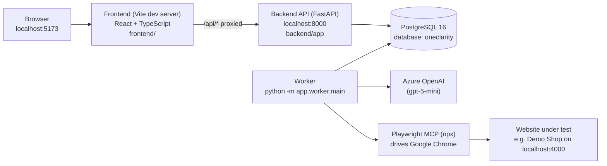

# 29 — Developer Setup and Handover

Everything a developer needs to get the OneClarity agent platform running on their own machine, and to work on it together with the rest of the team. Read this first; the other docs go deeper.

## 29.1 What you are setting up



Four processes run during development:

| Process | Command | URL | Role |
| --- | --- | --- | --- |
| API | `uv run uvicorn app.main:app --reload --port 8000` | http://localhost:8000/docs | REST API, live run stream (SSE), auth |
| Worker | `uv run python -m app.worker.main` | — | Picks queued runs and executes the agents (model + browser) |
| Frontend | `npm run dev` | http://localhost:5173 | The console UI |
| Demo Shop | `python3 -m http.server 4000 --directory eval-app/site` | http://localhost:4000 | Practice website with 6 planted bugs |

`./scripts/dev.sh` starts all four; Ctrl+C stops all of them.

## 29.2 Getting the code

The project folder is not a Git repository yet. Before handing over:

1. Create a **private** repository (GitHub / Azure DevOps).
2. From the project root:

   ```bash
   git init
   git add .
   git status            # check: no .env, no node_modules, no backend/var, no .venv
   git commit -m "Initial import of OneClarity agent platform"
   git branch -M main
   git remote add origin <your-repo-url>
   git push -u origin main
   ```

3. The new developer clones it: `git clone <your-repo-url> && cd <folder>`.

The root `.gitignore` keeps out secrets and local state. **Never commit** `backend/.env` (Azure key, encryption keys) or `backend/var/` (logs, screenshots, run folders).

Share secrets outside Git (password manager or Azure Key Vault), never in chat or email. Best practice: each developer gets **their own Azure OpenAI key** (or their own deployment) so usage can be tracked and keys can be revoked one by one.

## 29.3 Prerequisites

| Tool | Version used | Why | macOS install |
| --- | --- | --- | --- |
| Python | 3.12 | Backend | `brew install python@3.12` |
| uv | 0.9.x | Python packages + virtual env (`backend/.venv`) | `brew install uv` |
| Node.js | 22.x (npm 10+) | Frontend, and `npx` for the browser tool | `brew install node@22` |
| PostgreSQL | 16 | Database | `brew install postgresql@16 && brew services start postgresql@16` |
| Google Chrome | current | The agent's browser (Playwright MCP uses the installed Chrome) | chrome.com, or `npx playwright install chrome` |
| Git | any | Code | `xcode-select --install` |
| Docker (optional) | any | Run Postgres in a container instead of installing it | Docker Desktop |

Check: `python3 --version`, `uv --version`, `node -v`, `psql --version`.

**Linux (Ubuntu):** `sudo apt install python3.12 postgresql-16 nodejs npm google-chrome-stable`, install uv with `curl -LsSf https://astral.sh/uv/install.sh | sh`, then let your user create databases: `sudo -u postgres createuser -s $USER`.

**Windows:** use **WSL2 (Ubuntu)** and follow the Linux steps inside WSL. The shell scripts need bash.

## 29.4 Quick setup (about 5 minutes)

From the project root:

```bash
./scripts/setup.sh
```

It does, and is safe to run again:

1. `uv sync` in `backend/`: creates `backend/.venv` with all Python packages (from `uv.lock`).
2. Creates `backend/.env` from `.env.example` with a fresh `JWT_SECRET` and `SECRET_ENCRYPTION_KEY` (only if `.env` does not exist).
3. Creates the databases `oneclarity` and `oneclarity_test`.
4. `alembic upgrade head`: creates all tables.
5. Seeds: organization, admin user, QA Agent, Demo Shop target and task, starter org chart.
6. `npm install` in `frontend/`.

Then:

1. Open `backend/.env` and fill **`AZURE_OPENAI_ENDPOINT`** and **`AZURE_OPENAI_API_KEY`** (API version and deployment are pre-filled with `2025-04-01-preview` and `gpt-5-mini`; change them if your Azure resource differs).
2. Check Azure: `cd backend && uv run python scripts/check_azure.py` (one short prompt, prints the reply and tokens).
3. Start everything: `./scripts/dev.sh`.
4. Open http://localhost:5173 and sign in with **admin@oneclarity.local / change-me-now** (from `SEED_ADMIN_*` in `.env`).

No Azure key yet? Everything except the real agent still works: open **Agents → QA Agent → Overview**, set the runtime to **Fake (scripted demo)**, and runs use a scripted agent with the same live log, test cases, bugs and approvals.

## 29.5 Backend setup, step by step (what setup.sh does, by hand)

```bash
cd backend
uv sync                                   # creates .venv, installs runtime + dev packages
cp .env.example .env
uv run python -c "import secrets; print(secrets.token_urlsafe(48))"                                   # -> JWT_SECRET
uv run python -c "from cryptography.fernet import Fernet; print(Fernet.generate_key().decode())"     # -> SECRET_ENCRYPTION_KEY
# edit .env: paste both values, fill AZURE_OPENAI_*

createdb oneclarity
createdb oneclarity_test                  # used only by the tests
uv run alembic upgrade head               # tables
uv run python -m app.db.seed              # admin, QA agent, Demo Shop, org chart

uv run uvicorn app.main:app --reload --port 8000     # terminal 1: API
LOG_JSON=false uv run python -m app.worker.main     # terminal 2: worker
```

### Postgres in Docker instead of a local install

`docker-compose.yml` has a Postgres 16 service on port **5433** (user / password `oc` / `oc`):

```bash
docker compose up -d postgres
docker compose exec postgres createdb -U oc oneclarity_test
```

Then in `backend/.env`: `DATABASE_URL=postgresql+asyncpg://oc:oc@localhost:5433/oneclarity`, and for tests export `TEST_DATABASE_URL=postgresql+asyncpg://oc:oc@localhost:5433/oneclarity_test`. Run the API, worker and frontend on your machine as above (`setup.sh` expects a local `psql`, so do the database steps by hand).

> The `api` and `worker` services in `docker-compose.yml` are a starting point for deployment. The worker image does not contain Node.js or Chrome yet, so real browser runs only work when the worker runs on your machine. This is planned in milestone M6 ([28](28-roadmap.md)).

### `backend/.env` reference

| Setting | Required | Meaning |
| --- | --- | --- |
| `DATABASE_URL` | yes | Async SQLAlchemy URL of the main database |
| `JWT_SECRET` | yes | Signs login sessions (cookie) |
| `SECRET_ENCRYPTION_KEY` | yes | Fernet key that encrypts stored secrets (test logins, tokens). **Keep it for the life of the database**; a new key makes stored secrets unreadable |
| `AZURE_OPENAI_ENDPOINT`, `_API_KEY`, `_API_VERSION`, `_DEPLOYMENT` | for the real agent | Azure OpenAI resource and deployment |
| `AZURE_PRICE_INPUT_PER_1M`, `AZURE_PRICE_OUTPUT_PER_1M` | no | Prices for cost estimates (gpt-5-mini list price: 0.25 / 2.00) |
| `AZURE_REASONING_EFFORT`, `AZURE_VERBOSITY`, `CONTEXT_KEEP_RECENT_OUTPUTS` | no | Cost controls, see [27](27-cost-optimization.md) |
| `BROWSER_HEADLESS` | no | `false` shows the Chrome window the agent drives (useful for debugging) |
| `MAX_CONCURRENT_RUNS`, `RUN_TIMEOUT_SEC`, `SUBAGENT_*` | no | Worker limits, see [26](26-parallel-agents-orchestration.md) |
| `LOG_LEVEL`, `LOG_JSON`, `LOG_DIR`, `LOG_SQL` | no | Logging, see [21](21-logging-and-debugging.md) |
| `SEED_ADMIN_EMAIL`, `SEED_ADMIN_PASSWORD` | no | First admin created by the seed |

All settings and defaults: `backend/app/core/config.py`. Restart the API **and** the worker after changing `.env`.

## 29.6 Frontend setup, step by step

```bash
cd frontend
npm install          # .npmrc sets legacy-peer-deps=true (needed: TypeScript 6 vs openapi-typescript)
npm run dev          # http://localhost:5173
```

- The dev server proxies `/api/*` to `http://localhost:8000` (`vite.config.ts`), so the browser calls the API on the same origin and the login cookie just works. The API must be running.
- Stack: Vite 8, React 19, TypeScript 6, Tailwind CSS v4, shadcn/ui, TanStack Query, React Router 7, Recharts, React Flow, Motion. Details: [16](16-console-ui.md).

| Command | Use |
| --- | --- |
| `npm run dev` | Dev server with hot reload |
| `npm run typecheck` | TypeScript check only |
| `npm run build` | Type check + production build into `frontend/dist` |
| `npm run lint` | oxlint |
| `npm run gen:api` | Regenerate `src/api/schema.d.ts` from the running API's OpenAPI (run after any backend schema change) |

Adding UI components: `npx shadcn@latest add <component>` (config in `components.json`).

## 29.7 First check that everything works

1. **Fake run (no Azure needed).** QA Agent runtime → Fake. Tasks → *Full regression of Demo Shop* → **Run now**. The live log fills within seconds; a parallel version: **Run with options → Parallel agents**.
2. **Real run.** Set the runtime back to **OpenAI Agents SDK · Azure**. Same task → **Run with options** → tick only `/login.html` → **Start run**. Expect 1–3 minutes, a few cents, and the bug "wrong password accepted".
3. **Tests.** `cd backend && uv run pytest` → 45 passed (about 30 s; one test starts a real browser via `npx`, so Node and Chrome must be installed).

If a run stays **Queued**, the worker is not running (red banner in the UI).

## 29.8 Daily workflow

```bash
./scripts/dev.sh                    # start everything
cd backend && uv run pytest         # tests
uv run ruff check app tests && uv run ruff format app tests   # lint + format (line length 120)
cd ../frontend && npm run build     # type check + build
```

### Changing the database

1. Edit or add models in `backend/app/db/models/`.
2. `cd backend && uv run alembic revision --autogenerate -m "short description"`.
3. Read the generated file in `alembic/versions/` (autogenerate is not perfect).
4. `uv run alembic upgrade head`.
5. Commit the migration with the model change.

Two developers adding migrations at the same time create two "heads". Fix with `uv run alembic merge heads -m "merge"` before pushing, or agree who adds migrations when.

### Changing the API

1. Schemas in `backend/app/schemas/`, logic in `backend/app/services/`, routes in `backend/app/api/routers/`.
2. With the API running: `cd frontend && npm run gen:api` to update the TypeScript types.
3. Use the types through `src/api/client.ts` and hooks in `src/api/hooks.ts`.

### Changing the agent

- What the QA agent knows and how it tests: `backend/app/agents/qa/SKILL.md` (also editable per agent in the UI under Agents → Instructions).
- Platform rules added to every run and the browser tool list: `RUNTIME_NOTES` and `BROWSER_TOOLS` in `backend/app/runtime/openai_agents.py`.
- Tools the agent can call: `backend/app/runtime/tools.py` (`PlatformTools`) and their wrappers in `openai_agents.py`.
- Parallel runs: `backend/app/worker/orchestrator.py`.

### Documentation rules (agreed for this project)

- Docs live in `docs/` as numbered files; the index is [00-README](00-README.md).
- Every built feature gets an **F-number** row in [17-feature-log.md](17-feature-log.md).
- Every problem and its fix gets a **J-number** entry in [19-build-journal.md](19-build-journal.md).
- To avoid both of you taking the same number: pull before you add a row, and use the next free number.

## 29.9 Where things are

```
backend/
  app/
    main.py              FastAPI app, request-id middleware, routers
    core/                config (.env), logging, security (passwords, JWT, encryption), errors
    db/models/           SQLAlchemy models: org, agent, target, task, run, qa (cases, bugs, approvals), org chart
    db/seed.py           Seed data
    schemas/             Pydantic request / response models
    services/            Business logic (runs, analytics, org chart, ai_writer …)
    api/routers/         HTTP routes
    agents/<role>/       One folder per agent role: definition.py + SKILL.md (qa is live; sales, marketing, support planned)
    runtime/             Agent runtimes: openai_agents.py (Azure + Playwright MCP), fake.py, tools.py
    worker/              Queue claim, executor, orchestrator (parallel), heartbeat
  alembic/               Migrations
  tests/                 pytest (uses database oneclarity_test)
  scripts/check_azure.py Azure connectivity check
  var/                   Local logs, artifacts (screenshots), run work folders — not in Git
frontend/
  src/api/               Generated schema types, client, React Query hooks
  src/components/        ui/ (shadcn), common/, runs/, agents/, layout/
  src/pages/             One folder per screen
  src/lib/               Helpers (format, date ranges, org chart)
eval-app/                Demo Shop (static site with planted bugs) + BUGS.md answer key
scripts/                 setup.sh, dev.sh
docs/                    Numbered documentation
diagrams/                Excalidraw architecture diagrams
```

## 29.10 Working together

- **Branches:** `main` stays runnable. Work on `feature/<short-name>` branches and merge with a pull request; run the tests and `npm run build` before merging.
- **Own database each.** Each developer has a local `oneclarity` database. Share data by seed changes or migrations, not by copying databases.
- **Own `.env` each.** Same structure, own Azure key, own `JWT_SECRET` / `SECRET_ENCRYPTION_KEY`.
- **Targets with logins** (test accounts) are stored encrypted with your own key: each developer adds them in their own console (Target apps). The oneclarity.ai example is described in [25.8](25-setup-any-website.md#258-example-wwwoneclarityai-already-set-up-for-you).
- **Production websites** stay read-only for the agent: see the rules in [25.6](25-setup-any-website.md#256-production-sites-read-only-rules).
- **Costs:** every real run costs Azure money. Watch Usage & analytics; prefer the Fake runtime or the Demo Shop while building UI features.
- **Next work** is listed in [28-roadmap.md](28-roadmap.md).

## 29.11 Troubleshooting

| Symptom | Cause | Fix |
| --- | --- | --- |
| `zsh: command not found: #` when pasting commands | Pasted comment lines | Use `./scripts/setup.sh` and `./scripts/dev.sh`, or paste commands without `# …` lines |
| `npm install` fails with a peer dependency error | `.npmrc` missing | `frontend/.npmrc` must contain `legacy-peer-deps=true` |
| Run stays **Queued** | Worker not running | `./scripts/dev.sh` (the UI shows a red "No worker is running" banner) |
| "Azure OpenAI is not configured" | Missing `AZURE_OPENAI_*` | Fill `.env`, restart the worker, run `scripts/check_azure.py` |
| `Unsupported value / api-version` errors from Azure | API version missing or too old | `AZURE_OPENAI_API_VERSION=2025-04-01-preview` |
| Run fails at browser start | Node.js / npx or Chrome missing | `node -v`, install Chrome or `npx playwright install chrome` |
| Agent cannot load parts of a website | Browser is locked to the target's domain | Add the site's API / CDN / font domains under the target's **Extra allowed domains** ([25.2](25-setup-any-website.md)) |
| UI is blank after installing a package | Vite cached old dependencies | Stop dev, `rm -rf frontend/node_modules/.vite`, start again |
| Login fails after a fresh database | Not seeded | `cd backend && uv run python -m app.db.seed` |
| Stored test logins cannot be read | `SECRET_ENCRYPTION_KEY` changed | Restore the old key, or re-enter the logins on the target apps |
| Tests fail with "database oneclarity_test does not exist" | Test DB not created | `createdb oneclarity_test` |
| API error "Check the API log for request id …" | Server error | `grep <id> backend/var/logs/api.log` ([21](21-logging-and-debugging.md)) |
| Port already in use (8000 / 5173 / 4000) | An old `dev.sh` still running | `lsof -i :8000` and stop that process |

## 29.12 Cheat sheet

| What | Value |
| --- | --- |
| Console | http://localhost:5173 |
| API docs (Swagger) | http://localhost:8000/docs |
| Demo Shop | http://localhost:4000 (test login `demo@shop.test` / `demo123`) |
| Console login | `admin@oneclarity.local` / `change-me-now` (change it on shared machines) |
| Databases | `oneclarity` (app), `oneclarity_test` (tests) |
| Logs | `backend/var/logs/api.log`, `backend/var/logs/worker.log` |
| Screenshots and reports | `backend/var/artifacts/<run id>/` |
| Reset local database | `dropdb oneclarity && createdb oneclarity && cd backend && uv run alembic upgrade head && uv run python -m app.db.seed` (**deletes all local data**) |
