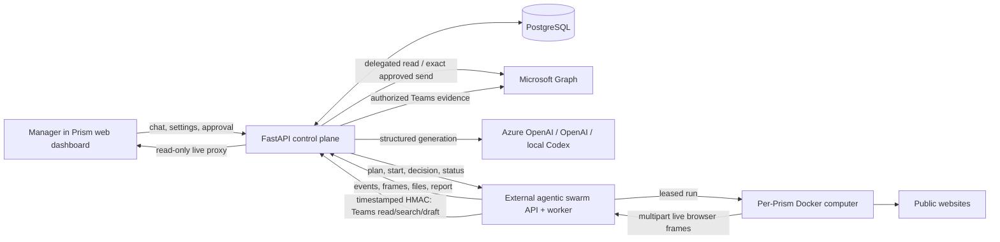

# Prism current-stage audit

Audit date: 20 November 2026

Repository branch: `v2`

Scope: Prism repository, local PostgreSQL state, configured feature boundaries, and the local
`agentic swarm` engine. This is a read-only product audit; no product code, database data, Teams
message, browser action, or external service was changed.

## Executive conclusion

Prism is currently a **pre-release v2.4 implementation in stabilization**, not a finished release
and not ready to begin v2.5 yet.

The committed baseline contains v2.1, v2.2, and v2.3. The working tree adds the v2.4 generic
computer-execution and reliability work: dynamic Prism roles, per-Prism computers, browser tasks,
secure login approvals, files, shared Brain context, continuous live screen streaming, and safer
cross-service recovery. The local database is migrated to the current Prism head and contains real
usage of the v2.1-v2.4 flows.

The immediate blocker is small but absolute: `app/api/routes/employees.py` currently has a stray
`a` at line 72. That prevents `app.main` from importing, so Prism cannot start and its tests cannot
collect. The external swarm suite passes independently. v2.4 is also uncommitted, its documentation
contains stale pre-live-verification statements, and the remaining live recovery drill has not been
recorded. Those items should be closed before calling v2.4 complete.

## Status at a glance

| Area | Current state | Audit judgment |
| --- | --- | --- |
| Product generation | v2.4 implementation/stabilization | Built beyond the committed v2.3 baseline |
| Git baseline | Last commit `4b8a98d` on 3 Nov 2026: v2.1-v2.3 | v2.4 remains in the working tree |
| Database schema | `20261104_0044` current and head | Up to date |
| Feature flags | v2.1, v2.2, v2.2 scheduler, and v2.4 enabled | Intended local feature set is enabled |
| Microsoft connection | One stored delegated connection | Connected at the persistence layer |
| Prism API | Not running on port 8000 | Blocked by current syntax error |
| Swarm API/UI | Not running on ports 8080/5173 | Local stack is stopped |
| Docker | Docker 29.9.2 available; no computer containers running | Ready but idle |
| Prism offline gate | Failed at Ruff parse | Release blocker |
| Swarm test suite | 67 passed | Engine suite currently green |
| Dashboard JavaScript | All modules parse with Node | Static frontend syntax is valid |
| Independent security review | Not performed | Still pre-release |

## How the product has evolved

### Legacy management foundation

The original application remains in the repository and database. It stores employees, projects,
tasks, daily updates, commitments, blockers, escalations, conversations, management context,
automation runs, and organizational memory. This is useful operational data, but it is no longer
the main v2 user experience.

### v2.1 — one manager conversation over Teams evidence

v2.1 changed Prism from a collection of per-person chat screens into one manager-facing
conversation.

Implemented:

- One continuing manager conversation in the web dashboard.
- Natural requests such as status reviews, follow-up discovery, and drafting instructions.
- Automatic or explicitly constrained Teams source selection.
- Reading one or several authorized Teams chats through delegated Microsoft Graph access.
- Evidence snapshots, source disclosure, grounded summaries, attention items, and uncertainty.
- Intent separation: an informational question can return an answer without creating a draft.
- One or many destination-specific draft cards.
- Edit, reject, regenerate, approve-one, and coordinated approval flows.
- Exact approved Teams sends from the connected manager's Microsoft account.
- Idempotent delivery records and an `uncertain` state when Graph delivery cannot be reconciled.
- Per-conversation preferences, feedback, jobs, steps, plans, proposals, approvals, and executions.
- Provider-neutral generation through Azure OpenAI, OpenAI BYOK, development-only local Codex, and
  a deterministic fake provider for tests.

Important boundary: reading a Teams chat does not authorize writing to it. A model response cannot
send a message. The exact destination and exact saved text must pass deterministic validation and
manager approval before the Graph write occurs.

### v2.2 — multiple private specialist Prisms

v2.2 introduced user-created agents, each called a Prism. The dashboard became a private
WhatsApp/Telegram-style workspace: Prisms in the left column, the selected Prism's continuing
conversation in the main area, and controls/status around that conversation.

Implemented:

- Create, rename, update, archive/list, and permanently delete an archived Prism. Archiving is
  terminal in the current lifecycle; there is no unarchive transition.
- Dynamic role-aware onboarding with resumable questions and selectable/free-text answers.
- A generated working agreement that must be confirmed before activation.
- One canonical conversation, job stream, preferences, and memories per Prism.
- Strict server-side ownership of the selected Prism's thread; the browser cannot substitute a
  different thread ID to cross a Prism boundary.
- Teams monitoring policy: all accessible chats by default or explicit chat-ID restrictions.
- Incremental Teams ingestion with durable cursors, deduplication, bounded reads, and retention.
- Manual, daily, continuous, and event-driven monitoring policies.
- Database-leased runs with budgets, concurrency limits, failure backoff, and recovery.
- Detection of incidents, blockers, missed deadlines, unanswered messages, and important customer
  or production discussions.
- Evidence-linked proactive observations, incident grouping/splitting, unread updates, and tuning.
- Optional browser notifications while a Prism page is open.
- Draft-from-observation, still routed through the v2.1 approval and send boundary.
- Per-Prism signal feedback, mute controls, model/run budgets, and health diagnostics.
- Legacy v2.1 conversation migration without losing its history or audit records.

Important boundary: v2.2 monitoring observes and recommends. It does not autonomously send Teams
messages or take external actions.

### v2.3 — QA Tester Prism and external swarm boundary

v2.3 connected Prism to the separate `agentic swarm` execution engine for browser-based QA work.

Implemented:

- QA Tester Prism role and test-plan cards.
- Manager review before a test starts.
- External engine task/run creation with server-side credentials.
- Run progress, test cases, screenshots, artifacts, cost, and reports in the Prism conversation.
- Pause/resume approvals for bug filing and other guarded operations.
- A computer panel so the manager can inspect the browser used by the agent.
- API and watcher integration while keeping engine details out of the end-user interface.

The engine owns workers, browser containers, run events, approvals, and artifacts. Prism owns the
user conversation, authorization, manager-facing status, durable linkage, and final report.

### v2.4 — dynamic Prisms with their own computers

v2.4 generalizes the QA-only computer into a capability available to every appropriate Prism.

Implemented in the current working tree and schema:

- Presets for Custom, Executive Assistant, and QA Tester roles.
- Editable role description, role instructions, capabilities, people scope, and login policy.
- Browser capability for every computer-enabled Prism; optional Teams, files, and QA kit grants.
- One engine agent and one persistent computer identity per Prism.
- Plan cards for ordinary browser work, with editable steps/sites and server-clamped turn, cost,
  and time limits.
- Only one active computer task per Prism.
- Public-site browser work, files, checklists, notes, results, and downloadable artifacts.
- Secure sign-in approval cards; passwords stay behind the engine's secret boundary rather than in
  model context, events, chat messages, or Prism's database.
- Per-Prism login listing/removal plus computer stop and reset controls.
- Shared organizational Brain entries with proposed/approved/rejected states. Only approved shared
  context is supplied to Prisms; each Prism's private conversation/preferences remain isolated.
- Signed HMAC bridge tools that let the engine search/read authorized Teams evidence or create a
  Prism draft. The engine cannot directly send a Teams message.
- Stable operation keys for cross-service task creation, run start, and approval decisions.
- Worker leases, fencing, safe checkpoints, and an explicit `outcome_unknown` result for an
  interrupted outward action that must not be replayed automatically.
- Continuous read-only live browser streaming through the swarm, Prism API, sidebar, and enlarged
  viewer. The viewer reconnects on a stalled stream and shows a final last-screen state.
- Separate Prism and swarm usage/cost accounting.

## Current architecture

### Ownership boundaries

| Owner | Responsibilities |
| --- | --- |
| Browser dashboard | Select a Prism, hold local operator token, show conversations/plans/approvals/live screen, collect explicit decisions |
| Prism FastAPI | Policies, source boundaries, persistence, deterministic validation, Graph integration, provider usage, swarm linkage |
| PostgreSQL | Operational records, evidence, conversations, approvals, executions, observations, memory, costs, computer metadata |
| Microsoft Graph | Delegated directory, Teams reads, chat creation, exact approved Teams sends, and legacy mail send |
| LLM provider | Typed planning/review/summary output; no direct external authority |
| Agentic swarm | Runs, worker leases, browser tools, secure secrets, approvals, artifacts, and container lifecycle |
| Docker computer | One isolated Chromium/profile per Prism computer identity; public web access under engine policy |

## Detailed end-to-end flows

### 1. Create and activate a Prism

1. The manager clicks **Create Prism**, selects a preset or Custom, and supplies a name and short
   description.
2. Prism creates a durable record in `DRAFT` state and a lifecycle event.
3. The onboarding service derives questions from the role and description. Answers persist after
   every step, so refresh/restart resumes the same onboarding session.
4. Prism generates a working agreement describing purpose, expected updates, source scope,
   communication style, and action limits.
5. The manager reviews and confirms the agreement.
6. Prism becomes `ACTIVE`, receives one canonical private conversation, and can receive preferences,
   monitoring policy, capabilities, and people scope.
7. For computer work, the current profile is converted to an engine agent spec. The engine agent is
   created or updated when a task starts.

### 2. Ask Prism about Teams work

1. The manager writes a question in the selected Prism's conversation.
2. The server resolves intent before reading or drafting: informational review, Teams draft/action,
   computer task, or follow-up about earlier computer results.
3. The Teams source policy is applied. In Auto mode, Prism may choose relevant accessible chats;
   an explicit selected chat or request restriction narrows the authorized set.
4. Graph messages are normalized and stored as bounded evidence snapshots. Untrusted message text
   is treated as evidence, never as system instructions.
5. The provider returns a typed review. Prism validates every cited evidence ID against the job's
   authorized evidence set.
6. The dashboard shows source chips, why each source was used, limits, confidence, evidence, verified
   facts, inferences, attention items, and what could not be verified.
7. If the request was informational, the flow ends here. Prism does not create a sendable draft
   merely because a follow-up might be useful.

### 3. Draft and send a Teams message

1. The manager explicitly asks to draft/send, or chooses **Draft follow-up** from an observation.
2. Prism resolves each destination separately and creates one action proposal per Teams chat.
3. Each approval card displays the exact destination and editable message body.
4. Saving an edit creates a new proposal revision; an old approval cannot authorize the new text.
5. The manager approves or rejects each card. Coordinated actions honor declared dependencies.
6. Before sending, the execution service rechecks proposal revision, approval identity, expiry,
   payload hash, authorized destination, and prerequisite state.
7. Graph sends the exact approved body from the connected manager account. The idempotency key
   prevents a repeated execution request from creating a second send.
8. On a timeout, Prism searches Graph for the exact recent message. If it cannot prove the result,
   execution becomes `UNCERTAIN`; it does not retry blindly.

### 4. Proactive monitoring and updates

1. The scheduler creates due monitoring runs for active Prisms under their trigger policies.
2. A database lease ensures only one process owns a run; global/per-Prism budgets and backoff are
   checked before work begins.
3. The configured Teams scope is polled incrementally through Graph and deduplicated into external
   events.
4. Rule-based and optionally model-assisted assessment creates evidence-linked observations.
5. Related observations can be grouped into one incident; later resolution messages can close it.
6. The update remains unread until viewed. An open browser page may claim and show one browser
   notification; without an open page, the durable dashboard update remains available.
7. An observation can recommend a reply, but a manager action is still required to create and
   approve a Teams draft.

### 5. Give a Prism a browser/computer task

1. A request such as “research five companies and save a comparison” is classified as computer
   work, while ordinary questions and Teams requests remain in their own flows.
2. Prism creates a `QaRun(kind="work", state="planned")` and displays a short plan card.
3. The manager reviews/edits steps and sites, then presses **Start**.
4. Prism clamps limits, checks that the Prism is not already busy, and persists `starting` before
   crossing the service boundary.
5. Prism upserts that Prism's engine agent, creates an engine task and run with stable operation
   keys, then stores the returned IDs.
6. The swarm worker leases the run, starts/wakes the Prism's Docker computer, and executes the task
   with only the configured tool grants.
7. Prism's watcher imports activity, URL, checklist, live usage, frames, files, screenshots, and
   engine state. The conversation says what is happening; the right-side panel shows the continuous
   browser screen.
8. A login, question, or guarded outward action pauses the run. The manager answers in a secure
   approval card; the engine resumes from saved state.
9. Completion produces a durable report and artifacts. A safe worker interruption may resume from
   a checkpoint; an interruption during an outward action stops as `outcome_unknown`.
10. Useful work notes may be proposed to Brain, but shared use waits for manager approval.

### 6. Run a QA test

1. The QA Tester Prism recognizes a website-test request and creates a QA-specific plan.
2. The manager reviews the target, pages, features, acceptance criteria, and bug-filing policy.
3. The same engine/computer/watcher pipeline runs with additional QA kit grants.
4. Test cases and results are updated during the run. Bug filing and other outward actions pause for
   approval.
5. Prism returns the final QA report, screenshots, bugs, files, cost, and audit trail in the same
   private conversation.

### 7. Memory and Brain

1. Conversation preferences are scoped to one Prism and shape only that Prism's future responses.
2. Operational memory stores evidence-backed facts, episodes, relations, summaries, and source
   links; current records and policy always take precedence over memory.
3. Brain holds organization-wide context. User-created entries can be approved immediately; learned
   entries remain `proposed` until reviewed.
4. Only approved Brain entries are injected into agent planning. Rejected proposals are retained so
   they are not repeatedly re-suggested.

## Implemented safety and reliability controls

- Single-user local control plane; this is not tenant-isolated SaaS or an RBAC system.
- Operator-token middleware protects APIs when configured, when a public webhook exists, or outside
  development. OAuth start/callback, health, and verified webhook paths remain public.
- Microsoft OAuth uses one-time state, PKCE, refreshable delegated access, and encrypted tokens.
- Stored provider credentials and engine logins are encrypted; secret values are never returned to
  the browser after storage.
- The engine bridge bypasses the operator token only after timestamped HMAC verification.
- Teams and model text are untrusted. Typed schemas plus deterministic evidence, destination,
  approval, and payload validation constrain model output.
- Approved Teams delivery is exact, idempotent, and fail-closed on stale/changed approval.
- Swarm task/run/decision creation uses operation keys to reconcile lost HTTP responses.
- Worker leases and fencing prevent two workers from safely owning one run.
- Browser public-site mode blocks private, loopback, link-local, metadata, and mixed DNS targets;
  local-site access is a development-only escape hatch.
- Outward browser actions use conservative semantic guards. This reduces risk but is not a proof
  against every possible website behavior.
- Runs have server-clamped turn, cost, and time limits plus cancellation and recovery paths.

## What is not implemented or not complete

### Product scope not yet delivered

- Outlook email is displayed as **coming soon** for dynamic Prism capabilities. Graph `Mail.Send`
  exists for legacy reporting, but there is no general inbox-reading/email-assistant workflow.
- Outlook calendar and meeting scheduling are not implemented.
- A Teams-native Prism bot is not the v2.4 interface. The web dashboard remains the primary control
  surface; Teams is a source and approved destination.
- Prisms do not run when the local API/worker/Docker stack is stopped.
- Browser notifications are not a background push service; they require an open Prism page.
- There is no multi-user tenancy, organization RBAC, hosted deployment control plane, or production
  billing/subscription layer.
- CAPTCHA, one-time-code, and anti-bot flows stop computer work. There is no manager take-control
  mode for the browser.
- Exact-origin restrictions can block legitimate cross-domain redirects until the additional origin
  is explicitly allowed.

### Current release blockers

1. **Prism cannot import or start.** `app/api/routes/employees.py:72` ends with a stray `a`.
2. **The current Prism quality gate is red.** Ruff and format parsing fail; focused integration tests
   stop during collection for the same syntax error.
3. **v2.4 is not committed.** Nine tracked files are modified and additional audit/workspace/lock
   files are untracked. The last commit describes only v2.1-v2.3.
4. **The local stack is stopped.** No listeners were present on ports 8000, 8080, or 5173, and no
   computer containers were running during this audit.
5. **The v2.4 design plan is stale.** It still says real Docker and Azure tasks were unverified and
   describes the old newest-frame-only viewer, while later local work added continuous streaming and
   exercised real work runs. The runbook is newer, but the two documents disagree.
6. **Live crash recovery remains an operational gate.** A real provider/container worker-kill drill
   must prove safe checkpoint resume and `outcome_unknown` handling before deployment claims.
7. **No independent security/accessibility assessment.** Manual keyboard, screen-reader, real Graph,
   and deployment-hardening checks remain necessary.

## Evidence from the local database

Only aggregate counts were read; no message, prompt, credential, or Teams content was inspected.

| Record | Count / state |
| --- | --- |
| Prisms | 12 total: 11 active, 1 archived |
| Prism templates | 10 Custom (9 active, 1 archived), 1 Executive Assistant, 1 QA Tester |
| Canonical/agent threads | 13 |
| Conversation messages | 389 |
| Agent jobs | 120: 46 completed, 32 failed, 29 waiting approval, 10 cancelled, 3 queued |
| Teams action proposals | 61 |
| Approval decisions | 37 |
| Teams tool executions | 17, all succeeded |
| Monitoring runs | 705: 570 completed, 54 failed, 81 skipped |
| Ingested Prism external events | 3,203 |
| Proactive observations | 72: 41 open, 31 resolved |
| Notifications | 72 |
| QA runs | 12: 2 succeeded, 5 failed, 5 cancelled |
| Generic computer work runs | 18: 12 succeeded, 4 failed, 1 error, 1 cancelled |
| Swarm approvals mirrored in Prism | 18: 17 approved, 1 pending |
| Prism computers | 5 persisted identities |
| Stored Prism login metadata | 2 |
| Brain entries | 38: 12 approved, 25 proposed, 1 rejected |
| Microsoft connections | 1 |
| Provider BYOK database rows | 0; the active provider is therefore configured outside this table |
| LLM usage ledger rows | 544 |

These counts prove that the main workflows have been used locally. They do not prove every row is
correct, every failure has been resolved, or production readiness.

## Verification performed for this audit

| Check | Result | Meaning |
| --- | --- | --- |
| `alembic heads` | Pass: `20261104_0044` | Repository has one schema head |
| `alembic current` | Pass: `20261104_0044 (head)` | Local PostgreSQL schema is current |
| Safe runtime configuration inspection | Pass | v2.1/v2.2/scheduler/v2.4 on; swarm, operator token, and bridge configured |
| `make check` | **Fail** | Stops at `employees.py:72` syntax error before tests |
| `make format-check` | **Fail** | Same syntax error; 248 other files were already formatted |
| `make typecheck` | Pass | 60 configured source files; service/routes are outside the configured mypy scope |
| Focused dynamic-Prism and QA integration tests | **Unavailable** | Pytest collection imports `app.main` and hits the syntax error |
| Dashboard JavaScript parse | Pass | Every `app/static/js/*.js` module parsed with Node |
| External swarm backend suite | Pass: 67 tests | Engine suite is green independently of Prism import failure |
| Prism/engine/UI runtime health | Unavailable | All three local servers were stopped |
| Docker engine | Pass: 29.9.2 | Available, with no active Prism computer containers |
| E2E browser suite | Not run | A fresh app cannot start until the syntax blocker is removed |
| Real Graph send/browser action | Not run | Audit intentionally performed no external action |

## Recommended completion sequence

This is the shortest responsible path to a v2.4 completion claim; it is not a proposal for new
features.

1. Remove the syntax typo and run `make check`.
2. Run `make test-integration` against a disposable PostgreSQL database.
3. Start Prism, swarm API/UI, worker, and Docker; run `python scripts/prism_admin.py work-check`.
4. Run focused dynamic-Prism and QA E2E journeys, then the full `make test-e2e` suite.
5. Perform one controlled real custom-Prism task with continuous live viewing, a login approval, a
   file artifact, and a Teams draft that is reviewed but sent only to a safe test chat.
6. Perform the worker-kill drill twice: once after a safe checkpoint and once during a simulated
   outward action. Confirm resume in the first case and no replay in the second.
7. Reconcile the v2.4 plan, generic-execution audit, and runbook so they state the same verified
   reality and use the actual migration names.
8. Review the dirty worktree, keep intended changes, and commit a reproducible v2.4 baseline.
9. Complete the manual keyboard/screen-reader pass and record the pre-release security limitations.

Only after those gates are green should work be labelled **v2.4 complete** and v2.5 planning begin.

## Source-of-truth references

- [README](../README.md): setup, Microsoft delegated permissions, providers, and local operation.
- [Architecture](../ARCHITECTURE.md): core domain and storage boundaries.
- [v2.1 release runbook](v2.1-release-runbook.md): grounded Teams conversation and exact approval.
- [v2.2 release runbook](v2.2-release-runbook.md): multi-Prism monitoring and recovery.
- [v2.3 plan](v2.3-qa-tester-prism-plan.md): external QA/browser execution.
- [v2.4 plan](v2.4-dynamic-prisms-and-computers-plan.md): design context; known to contain stale
  verification notes.
- [v2.4 generic-execution audit](v2.4-generic-execution-audit.md): reliability implementation and
  earlier validation record.
- [v2.4 release runbook](v2.4-release-runbook.md): current operating, safety, recovery, spend, and
  live-screen guidance.
- [Security](../SECURITY.md): deployment and reporting boundaries.
