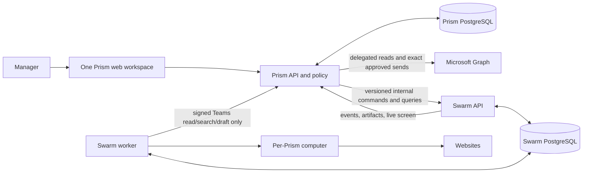

# Prism + agentic swarm: one product plan

Date: 20 November 2026
Status: implementation in progress; this document is the target architecture and release sequence

### Implementation note — 20 November 2026

The first Prism-side integration slice now adds a shared Work view, a shared computer-approval
inbox, per-Prism filtering, links into the originating private conversation, and a live-computer
shortcut for active work. The manager-facing interface continues to call Prism APIs only. Existing
run and approval records back these views, so this slice needs no database migration. The employee
alias delete route's stray character was also fixed because it prevented the API from importing.

This is not completion of all phases below. Cross-service service authentication, restart/recovery
drills, history reconciliation and a formal versioned contract still need implementation and proof.
Prism-to-Prism handoff, scheduled computer work, packaging, and release hardening remain later work.

### Interface decision update — 20 November 2026

The manager wants the major swarm console sections in Prism. The Prism sidebar now opens an
**Operations** area with Overview, Tasks, Runs, Approvals, Bugs, Agents, Organization, Target apps,
Secrets, and Usage. Prism renders these with its existing theme and calls only Prism API routes;
the swarm React frontend is no longer started by the unified local launcher. Its code remains in
the separate repository for diagnostic use. Engine-owned inventories and history are initially
read-only in Operations; task starts, exact Teams sends, and approval decisions continue through
the existing Prism workflows so the same scope and approval rules apply.

## 1. Product decision

Build **one Prism workspace** for a manager who supervises both people and AI coworkers. A Prism can
understand work from Microsoft Teams, answer privately, propose a task for itself or another Prism,
use its computer to do approved work, and bring the result back to the manager. The manager sees one
conversation, one work queue, one approval inbox, and one cost view.

The existing Prism application remains the user-facing product and policy authority. The existing
agentic swarm remains an internal execution service for computers, workers, run events, artifacts,
and parallel execution. A single product does **not** require putting both applications into one
Python process or combining their databases now. The swarm's separate React console becomes an
operator/debugging tool, not a second place the manager must use.

Paperclip is a useful reference for agent roles, assigned work, execution history, and oversight.
Prism's defining job stays specific: help a human manager understand and coordinate their real team
from Teams evidence, then supervise AI Prisms doing work. We should not add a generic company
hierarchy or broad connector catalog before those workflows are useful.

### A concrete end-to-end story

1. **Today** shows a release blocker from Teams and a QA task still running.
2. The manager asks Executive Assistant Prism: “What needs me before tonight's release?” It cites
   the relevant Teams messages and the QA task status separately.
3. It proposes “Ask QA Tester Prism to verify the checkout flow” as a task card. The manager edits
   scope and budget, then presses **Start**.
4. QA Tester Prism opens its computer. The manager can watch the live screen, steps, cost, and
   checklist from its chat or the Work page. A website login or outward action pauses for approval.
5. QA reports a reproducible bug with screenshots. Executive Assistant Prism summarizes the impact
   and drafts a Teams update. The manager edits and approves the exact message and destination.
6. Today and the task history show the same chain: Teams evidence → proposed work → run → result →
   approved message. No one has to log into the swarm console to understand it.

## 2. Starting point and gaps

| Existing in Prism | Existing in swarm | Gap for one product |
| --- | --- | --- |
| Private Prisms, onboarding, role instructions, per-Prism memory and approved shared Brain | Agent records, instructions, runtime, tool grants, budgets | Two agent profiles can drift; define one canonical owner |
| Teams Graph reads, proactive observations, manager chat, exact approved Teams sends | Browser tools and a signed Teams read/search/draft bridge | Show Teams evidence and computer work as one trace without expanding engine Teams authority |
| Plan cards and `qa_runs` for QA/general computer tasks | Tasks, runs, events, artifacts, sub-agent runs | Generic work needs one visible task identity and linked execution IDs |
| Teams proposals and approvals; mirrored swarm approvals | Engine approvals that pause runs | One inbox, with the enforcing service and final decision receipt clear |
| Today, Prism chat, Brain, settings, live computer, two spend columns | Separate React console: task board, runs, agents, approvals, bugs, usage, org chart, targets, secrets | One navigation and visual language for all major console sections inside Prism |
| Browser notifications and Teams monitoring schedules | Worker queue, leases, checkpoints, run budget and parallel QA | Connect proactive recommendations to reviewable task proposals |

These are code-level observations, not release claims. Prism's v2.4 work is still being stabilized:
the employee route import error has been fixed, while the working tree and live recovery drill
still need review. See [current-stage audit](current-stage-audit.md) for the earlier baseline.

## 3. Architecture and ownership



| Concept | Canonical owner | What the other side stores |
| --- | --- | --- |
| Prism identity, description, onboarding, private conversation, source scope, capabilities | Prism | An execution agent projection keyed to the Prism ID; no second user-editable profile |
| Manager request, plan, task proposal, human-facing status | Prism | Linked engine task and run IDs only after Start |
| Computer run, worker lease, checkpoints, tool events, raw artifacts, runtime budget | Swarm | Durable linkage and a safe manager-facing status summary |
| Microsoft connection, Graph tokens, Teams evidence, message approval and send | Prism | A signed, scoped bridge for read/search/draft; never a Graph token or Teams send tool |
| Browser/site action or login approval | Swarm enforces pause/resume | Prism displays and relays the decision, records an immutable receipt |
| Private memory and approved organizational Brain | Prism | Only task-scoped, approved context supplied at run start |
| Raw model usage for a computer run | Swarm | Prism imports it once by stable run ID for one consolidated spend view |

The two databases stay separate. Use stable `prism_id`, `work_id`, engine `task_id` and `run_id`
links, operation keys for every retriable write, and an event cursor for reconciliation. Never
depend on a transaction across both databases. A lost response must return the existing task/run,
not create another. A possibly completed outward action must remain **outcome unknown** until a
person checks the external system.

Prism capabilities are the maximum an engine agent may receive. Effective access for each run is
the intersection of Prism capabilities, its Teams/people policy, and the task's explicit scope.
Private Teams material from one Prism must not enter another Prism's context through delegation.
Only manager-approved Brain entries can be shared generally.

## 4. One user interface

Keep the current Prism theme, typography, colors, chat layout, and explicit approval controls.
Add work and Operations views inside that design. The initial release uses Prism's existing static JavaScript
modules and Prism API. Do not embed the swarm console or make the browser authenticate to the
swarm. Reuse its task/run ideas and API contracts; render the console sections in Prism. A
React migration can be considered after the unified workflows are stable, with visual and
behavioral parity as a separate project.

### Navigation and screen map

```text
Prism
├─ Today                  Team signals + AI work + approvals needing me
├─ Prisms                 Existing left-hand list; each opens its private chat
│  └─ Selected Prism      Chat | Work | About (same header and conversation)
├─ Work                   All AI tasks: proposed / queued / running / waiting / done
├─ Approvals              One inbox for Teams sends, site actions, logins and questions
├─ Operations             Swarm overview, tasks, runs, bugs, agents, org, targets, secrets, usage
├─ Team                   Existing Teams/people scope and work evidence
└─ Settings               Connections, provider, Brain, usage, runtime health
```

| Swarm console screen | Destination in Prism | UI rule |
| --- | --- | --- |
| Dashboard | Today | Combine team attention and agent work; use a single cost total with a drill-down split |
| Agents | Prisms and Operations → Agents | Prism owns creation/onboarding; Operations shows the execution agents and budgets |
| Tasks board and detail | Work and Operations → Tasks | Chat starts authorized work; Operations shows the engine task inventory |
| Runs and live run detail | Work, computer panel, Operations → Runs | Show status, current action, timeline, children, files, and result |
| Approvals | Global Approvals, chat cards, Operations → Approvals | Decisions go through Prism; Operations shows the engine's full inventory |
| Bugs and test cases | QA task result and Operations → Bugs | Keep QA detail with its run and allow a global bug list |
| Usage and analytics | Settings → Usage, Today summary, Operations → Usage | One total with provider and per-Prism/run breakdown; mark unpriced usage |
| Org chart | Operations → Organization | Show engine positions; separate human reporting lines from AI delegation |
| Targets and Secrets | Operations → Target apps and Secrets | Values stay hidden; site permissions and login scopes remain visible |

### Work detail layout

```text
┌─ Work: Verify checkout before release ── QA Tester Prism ── Running ──┐
│ Why: linked Teams blocker · Proposed by Executive Assistant Prism       │
│ Plan and scope · budget · started by you · Stop                          │
│                                                                         │
│ Timeline / checklist / sub-agent lanes     Live computer (expand)       │
│ Evidence and files                         Current action, URL, cost    │
│                                                                         │
│ Waiting decision card, if any · Result / bugs / next steps              │
└─ Back to QA chat · Back to originating manager request ────────────────┘
```

Show a status immediately after a task is submitted, even while the engine has not claimed it.
Display **queued**, **starting computer**, **running**, **waiting for you**, **completed**,
**failed**, **cancelled**, **engine offline**, and **outcome unknown** as different states. A
stalled live screen must say it is reconnecting; a saved screenshot must be labelled “last screen,”
never “live.” The manager can watch but cannot drive the browser in this plan.

The global approval inbox is for finding decisions; the originating chat stays the explanation.
An approval card must show the Prism, task, action, target, exact proposed content or screenshot,
expiry, and consequences. Approving a browser action does not approve a Teams send, and editing a
Teams draft invalidates its earlier approval.

## 5. Workflows to unify

### Ask → recommend → assign → execute → report

The manager's Teams question can produce an informational answer and optional work suggestion.
Prism creates a **proposed** work card only when the user requests work or explicitly chooses a
suggestion. It must not start a paid/browser run from an informational question. The manager edits
the assignee, scope, allowed sites, budget, and plan, then presses Start. Prism creates or finds
the engine task/run with an operation key. Engine events update one Prism work record, and final
results return to the Prism conversation with source links.

### Parallel execution and delegation

The swarm already supports parallel QA sub-agents. Show a parent task with child lanes, total
budget, per-lane state, and one merged report. Later, allow a Prism to **propose** work for another
Prism. The manager approves the handoff and scope before the recipient receives anything. The
recipient gets only the approved brief and selected evidence, not the sender's private chat or
unrestricted Teams access. A child cannot exceed the parent budget or delegate further unless
explicitly allowed. Prevent cycles, duplicate assignments, and ambiguous ownership.

### Proactive signals and schedules

Prism's Teams monitoring stays the source of proactive observations. A signal can create an
attention card and an optional task proposal, but not an automatic computer run or Teams send by
default. A future schedule may run a specifically approved repeatable task within a capped scope
and budget. Suppress duplicate signals and tasks for the same incident; preserve a link to the
latest evidence. Notifications remain browser-only while the page is open until another delivery
channel is intentionally added.

## 6. Development phases and completion gates

### Phase 0 — stabilize the existing boundary

- Fix the current Prism import error while preserving the user's UI edits; close the v2.4 offline
  gate and complete a controlled live recovery drill.
- Document the actual Prism ↔ swarm endpoints, status enums, operation-key behavior, and owners
  from code. Identify orphan engine agents/tasks and historical Prism `qa_runs` without deleting
  them. Record a baseline screenshot for Today, Prism chat, and live computer.
- **Complete when:** both services start, current v2.4 QA/general work flows pass, and the engine
  can be stopped/restarted without duplicating a task or action.
- **Manager can test:** create a harmless browser task, watch it live, and see its result in chat.

### Phase 1 — canonical identities and work contracts

- Specify a versioned internal contract for agent projection, task creation, start/cancel, events,
  approvals, artifacts, live stream, and costs. Use Prism UUID as the stable agent key and an
  idempotent mapping for existing engine agents. Replace repeated interactive engine login from
  Prism with scoped service authentication, without exposing it to the browser.
- Add a Prism-owned generic work identity linked to existing `qa_runs` and engine task/run IDs via
  additive migrations. Keep old API routes and historical URLs working. Define status mapping and
  sequence-based reconciliation after restarts.
- **Complete when:** one Prism edit updates the engine projection; retries return the same IDs;
  historical QA/general runs remain readable; scope/budget reductions are enforced server-side.
- **Manager can test:** edit one Prism's role/tools, refresh, and see the same settings and past work.

### Phase 2 — one read-only work surface

- Add a Work page and per-Prism Work tab under the current Prism shell. Import task/run state,
  parent/child lanes, current action, artifacts, QA results, and live screen through Prism APIs.
  Keep Today and chat linked to the same work IDs. Label engine-offline and stale data clearly.
- Show one consolidated spend total with Prism/model and computer-run breakdown, reconciled by
  stable run ID. No browser call to the swarm API or second login.
- **Complete when:** a manager can follow a running or historical task from Today → Prism chat →
  Work detail and back, with identical status, costs, files, and result.
- **Manager can test:** open a past QA run and a generic run; watch one live; refresh midway; verify
  its state and files remain available.

### Phase 3 — one action and approval workflow

- From chat or Work, create a proposed task, edit the plan/limits, start, stop, and deliberately
  retry a failed run. Merge pending decisions into one inbox while each original service still
  enforces its own approval. Use operation keys and receipts for every cross-service decision.
- Keep Graph sends inside Prism's exact approved-send service. The swarm's Teams bridge remains
  read/search/draft only. An uncertain browser or Teams outcome cannot be auto-retried.
- **Complete when:** the complete story in section 1 works without the swarm console, including
  a login/site-action pause and a separately approved Teams draft.
- **Manager can test:** start QA from a Teams-related suggestion, decide an approval, inspect the
  report, then approve a test Teams message. A double click must not duplicate anything.

**First unified-product release gate:** stop here if the manager can operate real Prisms and their
computers entirely from Prism. The next phases add orchestration depth, not basic UI unification.

### Phase 4 — coordinated Prisms and useful organization view

- Add explicit task proposals from one Prism to another, parent/child work links, bounded parallel
  execution, and a shared handoff brief. Offer a simple “Who works on what” view before an org
  chart. Keep human employees and AI Prisms visually distinct.
- Show delegation reason, approved evidence, owner, budget ceiling, progress, and final result in
  both the parent and recipient conversations. Never let a reporting-line edit grant permissions.
- **Complete when:** Executive Assistant can propose a QA task, the manager approves it, QA runs,
  and Executive Assistant can summarize the outcome without reading QA's private history.
- **Manager can test:** run two bounded QA lanes, pause one for approval, and see the merged result
  with accurate cost and attribution.

### Phase 5 — repeatable autonomous work

- Add manager-approved scheduled task templates, per-Prism concurrency and monthly budgets,
  deduplication, pause/resume, missed-run policy, and a clear activity log. Reuse the existing
  monitoring leases and engine worker leases rather than creating a second scheduler for one job.
- Keep outward actions on explicit approval unless a future policy is designed and reviewed for
  a narrowly defined action class. Show skipped/offline runs and next scheduled time in the UI.
- **Complete when:** a scheduled task survives restart, stays within its budget, reports results,
  and produces no duplicate external action after a worker interruption.
- **Manager can test:** schedule a harmless daily browser check, close/reopen Prism, and inspect
  the next run, result, and cost.

### Phase 6 — packaging and release hardening

- One local setup/start command and one documented URL for the manager; internal API, worker,
  Docker and PostgreSQL health appear in Settings. Keep the swarm console behind an operator-only
  path or disabled in normal mode. Pin compatible API versions and migrations for both services.
- Run disposable-DB migration and rollback checks, integration/browser journeys, accessibility
  review, Graph permission checks, real worker-kill recovery, cost reconciliation, and a backup /
  restore exercise. Preserve historical chats, approvals, files, and run references.
- **Complete when:** a fresh machine can start the product, a backup restores the unified history,
  and the manager needs only Prism for daily operation.
- **Manager can test:** use one start command, open one URL, and complete the section 1 story.

## 7. Migration and rollback rules

1. Never replace or rewrite the existing v2.1–v2.4 conversation or approval records in place.
   Add linkage tables/columns and backfill with repeatable scripts on disposable data first.
2. Preserve old `qa_runs`, engine tasks/runs, artifacts, and read URLs. Label engine-only historical
   work as “imported”; do not silently attach it to a Prism without a reliable mapping.
3. Ship read-only unified views before enabling new commands. Gate each command surface so it
   can be disabled without disabling current QA or Teams chat behavior.
4. Keep both databases backed up together with matching timestamps. A rollback restores the old
   UI/API contract while the engine continues to own its historical run records.
5. Reconcile event cursors and cost rows after a restart. Never infer “sent” from a missing HTTP
   response. A pending or unknown outward action requires an explicit human check.

## 8. Decisions and sequencing

- **Recommended now:** finish v2.4 stabilization, then build Phases 1–3 as the smallest useful
  merger. Treat Phases 4–6 as subsequent releases.
- **Frontend decision:** retain Prism's current shell and theme for the first release. Consider a
  single React frontend only after the combined workflows are stable and the port can preserve
  chat history, keyboard behavior, approvals, and live viewing.
- **Deployment decision:** keep two internal services and databases initially. Put them in one
  development launcher/deployment package after the API contract is stable. A physical code or
  database merger has no user benefit yet and carries migration risk.
- **Scope decision:** Outlook email/calendar, tenant-wide RBAC, arbitrary external agent runtimes,
  automatic agent-to-agent permissions, and a full company org chart remain separate proposals.

## 9. Implementation references

- Prism [current-stage audit](current-stage-audit.md), [v2.4 runbook](../releases/v2.4-release-runbook.md),
  `app/services/qa_run_service.py`, `app/services/qa_swarm_client.py`,
  `app/services/work_bridge_service.py`, `app/services/approved_teams_execution_service.py`,
  `app/static/index.html`, `app/static/js/qa-tester.js`.
- Swarm repository currently at `/Users/yashmandi/Downloads/agentic swarm`:
  `backend/app/api/routers/runs.py`, `backend/app/worker/executor.py`,
  `backend/app/computers/manager.py`, `frontend/src/router.tsx`,
  `frontend/src/components/layout/app-sidebar.tsx`, and `docs/30-computers-and-generic-agents.md`.
  Some older swarm docs describe pre-v2.4 ports/browser setup; verify contracts against code.
