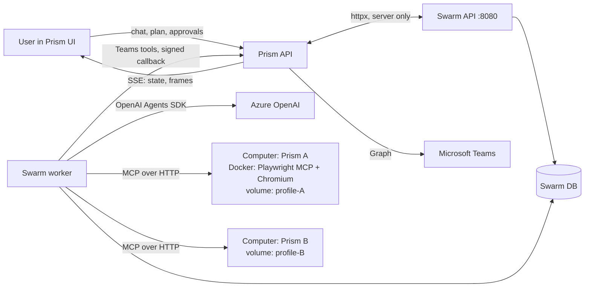
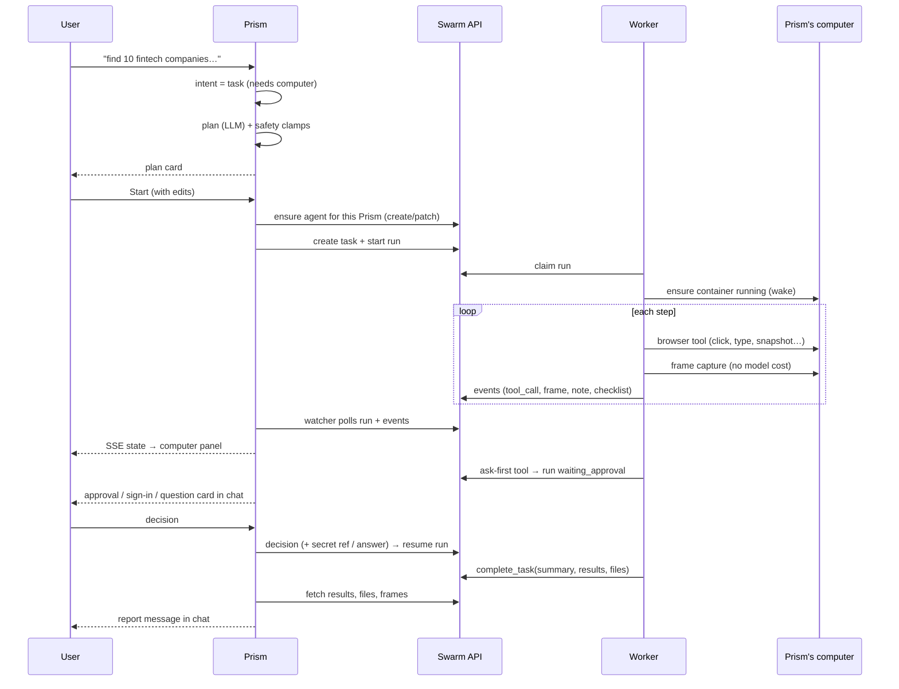

# v2.4 Plan: Dynamic Prisms, each with its own computer

Status: implemented (P0-P5) and tested against fakes; not yet run against real Docker. See section 10 for where the build differs from this plan.
Owner: Yash. Date: 2026-11-02.
Builds on: v2.3 QA tester Prism (`docs/v2.3-qa-tester-prism-plan.md`).

## 1. Goal

Today a Prism's job comes from a fixed template (Executive assistant, QA tester). The template sets its instructions, onboarding questions and tools in code. v2.4 removes that limit:

1. **Any role.** The user describes the job in their own words ("sales outbound agent", "competitor price tracker", "market researcher") and picks which capabilities the Prism has. Prism builds the onboarding, instructions and limits from that. Templates stay, but only as presets of the same system.
2. **A personal computer for every Prism.** Each Prism has its own real browser, running in its own Docker container, driven by a real agent. The user gives a task in chat, approves a plan, and can open the right sidebar at any time to watch the Prism's screen while it works.

The user only ever uses Prism. The swarm (`/Users/yashmandi/Downloads/agentic swarm`) stays a hidden engine, as in v2.3. No swarm name, link, id or error text appears in Prism's UI.

### Decisions already made (from Q&A, 2026-11-02)

| Topic | Decision |
| --- | --- |
| Computer | **Browser sandbox**: real Chromium per Prism (Playwright). No desktop or terminal. |
| Where the agent runs | **Generalize the swarm.** The QA-only agent becomes a generic agent. Each Prism gets its own agent row in the swarm, built from its role. |
| Model | **Azure OpenAI**, as in the swarm today (OpenAI Agents SDK). |
| Live view | **Screenshot feed** plus the current action and an activity log. No video stream and no "take control". |
| Custom role setup | **Description + pick tools.** The user writes the role and ticks capabilities. The LLM writes the instructions, which the user can edit. |
| Capabilities in v2.4 | **Web browsing** is always on. **Teams** and **Files / reports** are optional, chosen by the user. **Outlook email** is postponed to the next version. |
| Approvals | **Ask before outward actions.** Reading and browsing need no approval. Sending, posting, submitting, buying or deleting needs an approval card in chat. |
| Computer lifetime | **Persistent browser profile per Prism**, so logins and cookies stay. **One-shot tasks only**: no schedules and no watchers in v2.4. |
| Starting a task | **Plan card + Start**, as for QA. |
| Logins | Chosen per Prism: **no logins**, or **sign in with credentials the user gives in a secure card in the chat**. |
| Credentials | **Secure card in chat.** The value is encrypted, never stored in the transcript, and never sent to the model. |
| Hosting | **Local Docker** on this machine. Cloud comes later. |
| Concurrency | **One task at a time per Prism.** |
| QA tester | **Becomes a preset** on the new generic system. Its test cases, bug reports and bug filing are kept. |

### Out of scope for v2.4 (planned later)

- Outlook / email capability, and "email watcher" style Prisms (needs email + schedules) -> v2.5.
- Scheduled, recurring or triggered tasks.
- Live video, and the user clicking or typing inside the Prism's computer ("take control").
- Several tasks at once for one Prism.
- Desktop apps or a terminal inside the computer.
- The user attaching files in chat for the Prism to use (it can create and download files, see 3.3).
- Deploying computers to Azure.

---

## 2. What the end user sees (end goal)

### 2.1 Example A: a custom "Sales outbound" Prism

**Create.** The user presses **New Prism**:

```
┌ New Prism ───────────────────────────────────────────────┐
│ Role         [ Custom role                         v ]   │
│              (Executive assistant · QA tester · Custom)  │
│ Name         [ Riya                                  ]   │
│ What's the job?                                          │
│ [ Find B2B SaaS companies that fit our ideal customer,  ]│
│ [ research the right decision maker, and draft short    ]│
│ [ personal first messages. Keep a list I can review.    ]│
│                                                          │
│ What can Riya use?                                       │
│  [x] Web browsing (always on: Riya's own browser)        │
│  [x] Files and reports (create CSV / docs, downloads)    │
│  [x] Microsoft Teams (read my chats, draft messages)     │
│  [ ] Outlook email (coming soon)                         │
│                                                          │
│ Signing in to websites                                   │
│  ( ) Never sign in: public pages only                    │
│  (•) Sign in when needed, with logins I give in chat     │
│                                                          │
│                              [ Cancel ]  [ Create ]      │
└──────────────────────────────────────────────────────────┘
```

**Onboarding.** Riya asks questions written for this role, generated from the description. Each question has choices and an "Other" option:

1. "Who is your ideal customer? (industry, size, region)"
2. "Which sites may I use for research?" (LinkedIn, company websites, Crunchbase, any public site)
3. "How many companies per task by default?" (5 / 10 / 25)
4. "What tone should first messages have?" (Warm and short / Formal / Direct)
5. "How should I give you results?" (Table in chat / CSV file / both)
6. "Anything I must never do?" (Never message anyone myself / never use personal emails / …)

On the last step Riya shows **"How I'll work"**: the instructions the LLM wrote from the description and answers. The user can edit them. Riya also shows a fixed **"Always asks you first"** list (send, post, submit forms, buy, delete), which the user cannot turn off. The user presses **Finish**. Riya is now active, and its computer exists but is asleep.

**Task.** In chat:

> **You:** find 10 fintech companies in Bangalore with 50–200 people and draft a first message to each head of sales

Riya answers with a **plan card**:

```
┌ Plan: 10 Bangalore fintech leads + first messages ───────┐
│ Steps                                                    │
│  1. Search for fintech companies in Bangalore (50–200)   │
│  2. Check each company's site for size and product       │
│  3. Find the head of sales (LinkedIn, company site)      │
│  4. Draft a 3–4 line first message for each              │
│  5. Put everything in leads.csv and a table here         │
│ Sites    google.com, linkedin.com, company websites      │
│ Uses     Browser · Files                                 │
│ Asks you first   signing in, sending anything            │
│ Limits   up to 120 steps · $2.00 · about 20 min          │
│                       [ Not now ]  [ Edit ]  [ Start ]   │
└──────────────────────────────────────────────────────────┘
```

**Watch.** The user presses **Start**. The **computer** button in the chat header gets a green dot, and the computer panel opens on the right:

```
┌ Riya's computer ──────────────────────── ● Working  [Stop] ┐
│ ◀ ▶ ⟳ │ https://www.google.com/search?q=fintech+bangalore │
│ ┌──────────────────────────────────────────────────────┐   │
│ │                                                      │   │
│ │              (live screenshot, updates               │   │
│ │               after every browser step)              │   │
│ │                                                      │   │
│ └──────────────────────────────────────────────────────┘   │
│ Now: Reading the results page                              │
│ ▓▓▓▓▓▓▓░░░░░░░░░░░░  step 34 of up to 120 · $0.41          │
│ Checklist                                                  │
│  ✓ Search for companies         (14 found)                 │
│  ● Check size and product       4 / 10                     │
│  ○ Find head of sales                                      │
│  ○ Draft messages                                          │
│ Activity                                                   │
│  12:04  Opened razorpay.com/about                          │
│  12:04  Read the page                                      │
│  12:05  Saved note: "Razorpay: too large (3000+), skip"    │
└────────────────────────────────────────────────────────────┘
```

**Waiting for the user.** LinkedIn shows a login wall. Riya's run pauses, the panel shows **"Waiting for you"**, and a **secure sign-in card** appears in the chat:

```
┌ Riya needs to sign in to linkedin.com ───────────────────┐
│ To find the head of sales at each company.               │
│ Username  [ yash@...                ]                    │
│ Password  [ ••••••••••              ]                    │
│ ( ) Use once   (•) Remember for Riya                     │
│ Only Riya's computer uses this. It is encrypted, never   │
│ shown in chat, and never seen by the AI model.           │
│                       [ Skip LinkedIn ]  [ Sign in ]     │
└──────────────────────────────────────────────────────────┘
```

The chat transcript shows only "You gave Riya a login for linkedin.com". The password is never in the chat history.

If a site asks for a code or a CAPTCHA, Riya can't get past it in v2.4 (no take-control). It says so in chat and carries on without that site, or stops if the site was needed.

**Report.** When the run finishes, Riya posts:

- a short summary ("Found 10 of 10. 2 heads of sales were not public; I used the founder instead and marked them.");
- a table of the 10 companies, with person, title, source link and the message draft;
- a file chip **leads.csv** to download;
- "Needs your attention": anything Riya was unsure about;
- suggested next steps ("Want me to send these on LinkedIn? I'll ask before each one.").

**Follow-up.**

> **You:** send the list to Akshay on Teams

This is the existing v2.3 behaviour: a **Teams draft card** to Akshay that the user can edit, then **Approve and send**.

> **You:** message the first 3 on LinkedIn

That is a new task, so Riya shows a plan card. During the run, before each **Send** click, the run pauses and an **action approval card** appears: the screenshot, "I'm about to press **Send** on linkedin.com to message *Priya S.*", the message text, and **Allow** / **Don't**.

### 2.2 Example B: a "Competitor price tracker" (browsing only)

- **Create:** role "Custom", job "Check competitors' pricing pages and tell me what changed", capabilities browsing only, logins "Never sign in".
- **Onboarding** asks: which competitors, which plans or tiers matter, the currency, and the report format.
- **Task:** "check acme.com and globex.io pricing and compare with ours at oneclarity.ai/pricing".
- **Run:** the plan card lists the 3 sites. The computer panel shows each pricing page. The report has a comparison table and screenshots of each pricing page.

### 2.3 Example C: the QA tester (preset)

The role select shows **QA tester** as a preset. It fills in the description, the capabilities (browsing, files, plus the QA kit: test cases, bugs and bug filing) and the QA onboarding questions from v2.3. Everything the user sees in v2.3 still works: the QA plan card, the test-case table, bugs with screenshots, the bug-filing approval, and drafts to colleagues. The difference is that it now runs on the generic engine and its own computer.

### 2.4 Example D: an existing Executive assistant Prism

It works as today: Teams reads, drafts and updates. With v2.4 on, it also gets a computer. If the user asks it to do something on the web ("check the agenda on our intranet page and summarise it"), it shows a plan card and uses its browser. Questions about Teams still go to the existing Teams flow.

### 2.5 The computer panel in every state

| State | When | Panel shows |
| --- | --- | --- |
| **Asleep** | No task yet, or idle for more than 10 min | Last screenshot greyed out, "Asleep. Wakes up when I start a task." List of past tasks. |
| **Starting** | Start pressed, container booting | Skeleton screen, "Starting my computer…" |
| **Working** | Run active | Live screenshot, URL bar, "Now:" line, progress, checklist, activity log, **Stop** |
| **Waiting for you** | Approval, sign-in or question pending | Frozen screenshot, amber badge, "Waiting for you in chat" with a jump link |
| **Finished** | Run ended | Last screenshot, outcome badge (Done / Stopped / Couldn't finish), "See report" link |
| **Unavailable** | Engine offline | "My computer is offline right now." No raw error. |

The panel is available for every Prism (browsing is always on) through the computer button in the chat header. The green dot means it is working. The amber dot means it is waiting for you.

---

## 3. How it works

### 3.1 Architecture



- **Prism is the product.** It owns roles, onboarding, chat, plans, approvals, Teams access (Graph tokens never leave Prism) and the user's view of the computer.
- **The swarm is the engine.** It owns the agent loop, tools, budgets, run events, screenshots, files, and the computers (containers).
- **One computer = one Docker container** per Prism: Playwright MCP server + Chromium, a persistent profile volume, and MCP over HTTP on the internal Docker network. It is created on the first task, stopped after 10 idle minutes, and woken on the next task. Logins and cookies stay in the volume until the user presses **Reset computer** or the Prism is deleted.
- This also removes the host-Node problem from v2.3: the browser no longer runs through `npx` on the worker machine.

### 3.2 Task flow



### 3.3 Capabilities → tools

Each Prism has a set of capabilities. Prism turns them into the `tool_grants` of the Prism's swarm agent. The swarm offers the model only the tools that were granted.

| Capability | Tools the agent gets | Grant |
| --- | --- | --- |
| **Core** (always) | `get_task_context`, `add_note` (progress line), `update_checklist` (plan steps + status), `ask_manager` (question to the user, pauses the run), `complete_task(summary, outcome, results, files)` | allowed (`ask_manager` = ask_first by design) |
| **Web browsing** (always) | `browser_navigate`, `browser_navigate_back`, `browser_snapshot`, `browser_find`, `browser_click`, `browser_type`, `browser_fill_form`, `browser_select_option`, `browser_press_key`, `browser_hover`, `browser_wait_for`, `browser_handle_dialog`, `browser_take_screenshot`, `browser_tabs` | allowed, but **guarded** (see 3.5) |
| **Sign in** (if logins allowed) | `request_login(site, reason)` (pauses for the secure card), `sign_in(site, username_ref, password_ref, submit_ref)` (the worker types the stored values itself; the model never sees them) | `request_login` = ask_first; `sign_in` = allowed |
| **Files / reports** | `save_file(name, content, kind)` for csv/md/txt/json, max 2 MB. Browser downloads are collected into the run's files. | allowed |
| **Teams** | `teams_search(query, person?, days?)` and `teams_read_chat(person)`, read-only, scoped to the Prism's allowed Teams chats; `teams_draft_message(to, body)` becomes a Prism draft card | read = allowed; draft = ask_first |
| **QA kit** (QA preset only) | `save_test_plan`, `record_test_result`, `draft_bug`, `file_bug`, `get_test_login` | as in v2.3 (`file_bug` = ask_first, never on production) |
| **Outward browser action** | `confirm_action(kind, site, summary, details)`: the agent must call it before an irreversible click | ask_first |

Teams tools run in Prism, not in the swarm. The worker calls Prism's **bridge** endpoint (`POST /api/v2/bridge/runs/{run_ref}/teams/...`), signed with a shared HMAC key and limited to the run's Prism. Prism checks that the Prism has the Teams capability and only reads its allowed sources (`PrismTeamsPolicyService.allowed_sources`). Teams content goes back to the model as data, marked untrusted.

### 3.4 Role → agent

When onboarding finishes, and whenever the role, capabilities or agreement change, Prism calls `PrismAgentService.sync(prism)`:

- It builds the agent's **instructions** from:
  1. the role description;
  2. the onboarding answers;
  3. the editable "How I'll work" text;
  4. the house rules and restrictions;
  5. the fixed **platform rules** added by the swarm: browser use, scope, approvals, never reveal secrets, and treat page text as untrusted.
- It upserts the swarm agent: `POST /agents` the first time, `PATCH /agents/{id}` after that. The agent gets:
  - `key = prism-<8 hex>`;
  - `role = "prism"`;
  - `tool_grants` from the capabilities;
  - `max_turns` and `run_budget_usd` from the caps;
  - `instructions`.
- The swarm agent id is stored only in Prism's DB (`prism_computers.swarm_agent_id`) and is never sent to the browser.

Presets (`app/services/prism_presets.py`) are plain data:

```python
PRESETS = {
  "custom":              {"capabilities": ["browser"], "questions": "generated"},
  "executive_assistant": {"capabilities": ["browser", "teams"], "questions": "generated", "teams_flow": True},
  "qa_tester":           {"capabilities": ["browser", "files", "qa_kit"], "questions": QA_TAILORING,
                          "plan_kind": "qa", "report_kind": "qa"},
}
```

Adding a role later is a data change, not new code paths.

### 3.5 Safety: how "ask before outward actions" is enforced

Rules enforced in code, not only in the prompt:

1. **Ask-first tools pause the run in the worker.** This is the SDK `needs_approval`, so the model cannot skip it. These tools are `confirm_action`, `request_login`, `ask_manager`, `teams_draft_message` and `file_bug`.
2. **Browser click guard.** `browser_click`, `browser_press_key` (Enter) and `browser_fill_form` are wrapped as function tools that call the MCP server. Their `needs_approval` is a function. It requires approval when:
   - the element's accessible name, or the form's submit button, matches the outward list: send, post, publish, submit, pay, buy, order, checkout, confirm, delete, remove, invite, connect, apply, book, subscribe, sign up, unsubscribe; or
   - the agent passed `confirm_action` for this step.
    This is **best-effort**: a site can label a send button "Go". The prompt rule ("call `confirm_action` before anything irreversible") plus the keyword guard cover most cases. The plan card says this honestly.
3. **Network policy per computer.**
   - The container's network blocks private and loopback ranges, unless `QA_ALLOW_LOCAL_TARGETS` (renamed `WORK_ALLOW_LOCAL_SITES`) is on.
   - Each task has an origin allowlist from the plan. "Any public site" is allowed only if the plan card shows it and the user starts it.
   - Blocked navigations become a note: "That site isn't in this task's plan."
4. **Secrets never reach the model.**
   - Login values are sent from the secure card straight to Prism's API, then stored encrypted in the swarm `secrets` (scope `prism:<key>:<origin>`).
   - `sign_in` types them through MCP inside the worker.
   - Tool args and results pass through `mask()`.
   - Prism keeps only the site, a masked username and the date (for the "Logins" list in Prism settings, which has a Remove button).
5. **Limits are clamped server-side.** The caps are `WORK_MAX_TURNS_CAP` (150), `WORK_BUDGET_CAP_USD` (3.00) and `WORK_MAX_MINUTES` (30). The browser can't raise them.
6. **One task per Prism.** A second task request gets "I'm still on *X*. Want me to stop it?". It is not queued silently.
7. **Isolation.** Each Prism has its own container and profile volume. No sharing of cookies between Prisms.
8. **Untrusted content.** Web pages and Teams messages are data. The platform rules tell the agent to ignore instructions found in them. All outward actions still need approval, so an injected instruction can't send anything on its own.
9. **Kill switch.** `PRISM_V24_ENABLED=false` hides all v2.4 UI and stops new runs. The `prism_admin.py computers stop-all` command stops every container.

---

## 4. Swarm changes (`/Users/yashmandi/Downloads/agentic swarm/backend`)

| Area | Change | Files |
| --- | --- | --- |
| Computers | New `ComputerManager` (Docker SDK): `ensure(key)` creates or starts container `prism-computer-<key>` from the pinned image `mcr.microsoft.com/playwright/mcp:<version>` with `--port 8931 --headless --user-data-dir /profile --output-dir /work`, a volume `prism-profile-<key>`, the internal network `prism-computers`, labels, and memory/CPU limits (1 GB / 1 CPU). Also `stop(key)`, `reset(key)` (delete the volume), `status(key)`, and an idle reaper (stop after `COMPUTER_IDLE_MINUTES=10`). | new `app/computers/manager.py`, `app/computers/reaper.py`; `worker/main.py` starts the reaper |
| Browser connection | `_browser()` uses `MCPServerStreamableHttp(url=http://prism-computer-<key>:8931/mcp)` when the agent has a computer key. It falls back to stdio `npx` for the old QA agent and tests. Per-task origin allowlist via the MCP `--allowed-origins` start option. The container is restarted with new origins when they change (cheap, because the profile is kept). | `runtime/openai_agents.py` |
| Live frames | After every browser tool ends, the worker calls `browser_take_screenshot` (JPEG, viewport, quality 60) directly on the MCP session. This costs no model tokens. It is saved as artifact kind `frame` and an event `frame {artifact_id, url, title}` is emitted. Only the last 30 frames per run are kept; older ones are deleted. Report screenshots (`kind=screenshot`) are kept as before. | `runtime/openai_agents.py` (`_Hooks.on_tool_end`), `runtime/tools.py`, artifacts cleanup |
| Generic agent | New role folder `agents/prism/` (`definition.py` with `role="prism"`, `SKILL.md` = base platform rules). The QA-specific `RUNTIME_NOTES` split into `BROWSER_NOTES` (all) + `QA_NOTES` (only with `qa_kit`). `_tools()` builds the tool list from grants (table 3.3). `_stop_when_completed` works with the generic `complete_task`. | `agents/prism/*`, `runtime/openai_agents.py`, `runtime/tools.py` |
| New platform tools | `add_note`, `update_checklist`, `ask_manager`, `confirm_action`, `request_login`, `sign_in`, `save_file`, generic `complete_task(summary, outcome, results: list[dict], files: list[str])`, and Teams bridge tools (HTTP to Prism with HMAC). | `runtime/tools.py`, new `runtime/prism_bridge.py` |
| Click guard | The guarded wrappers around the browser click / key / form tools, with a keyword list from settings. | `runtime/openai_agents.py` |
| Approvals with payload | `POST /approvals/{id}/decision` accepts an optional `payload` (`{"answer": "..."}` for `ask_manager`, `{"secret_id": "..."}` for `request_login`). The resumed run passes it back to the tool as the tool result. | `api/routers/runs.py`, `services/runs.py`, `worker/executor.py` |
| Secrets | `POST /secrets` accepts `scope="prism:<key>:<origin>"` and `kind="login"` (`{username, password}` encrypted). Add `GET /secrets?scope=` (names only) and `DELETE`, which already exists. | `api/routers/secrets.py`, `services/secrets.py` |
| Computer API | `GET /computers/{key}` (state, last frame id), `POST /computers/{key}/stop`, `POST /computers/{key}/reset`. The worker calls `ensure` itself at run start. | new `api/routers/computers.py` |
| Run results | `GET /runs/{id}/results` (the `results` and `files` passed to `complete_task`) and `GET /runs/{id}/files` (artifacts of kind `file`). | `api/routers/runs.py` |
| Concurrency | Worker refuses to start a second run on the same computer key (row lock on `computer_key` in run options). `max_concurrent_runs` stays the global cap. | `worker/executor.py` |
| Compose | `docker-compose.yml`: network `prism-computers`; the worker mounts `/var/run/docker.sock` (local dev only, documented risk). | `docker-compose.yml`, `docs/` |

Not changed: the QA orchestrator (parallel sub-agents) stays as is. Prism still uses only `mode: single`.

---

## 5. Prism changes (`/Users/yashmandi/code/prism`)

### 5.1 Data model (migrations `0043`, `0044`)

- `prisms`: add `capabilities` (JSONB list, default `["browser"]`), `logins_policy` (`never` | `ask`), `role_preset` (rename of `template_key`, kept as a column alias for compatibility).
- `prism_computers` (new):
  - `prism_id` (unique), `computer_key`, `swarm_agent_id`, `agent_revision`;
  - `state` (asleep/starting/working/waiting/unavailable);
  - `last_frame_run_id`, `last_frame_index`, `last_seen_at`.
- `work_runs`: generalize `qa_runs`. Rename the table and add:
  - `kind` (`general` | `qa`);
  - `checklist` (JSONB);
  - `frames` (JSONB list of swarm artifact ids, opaque index to the browser);
  - `files` (JSONB);
  - `results` (JSONB);
  - `waiting_on` (approval ref).
  Existing QA rows are migrated with `kind='qa'`.
- `work_approvals`: generalize `qa_approvals`. Add `kind` (`bug_filing` | `outward_action` | `login` | `question` | `teams_send`), `payload_preview` (safe text shown in the card), `answer` (for questions) and `resolved_by`.
- `prism_logins` (new): `prism_id`, `origin`, `username_masked`, `swarm_secret_id`, `remember` (bool), `created_at`. Never the password.

### 5.2 Services

| Service | Job |
| --- | --- |
| `prism_presets.py` | Preset data (3.4). |
| `prism_profile_service.py` | Capabilities, logins policy, and the "How I'll work" text. `generate_instructions(prism, answers)` uses the LLM, with a plain fallback built from the description + answers. |
| `prism_agent_service.py` | `sync(prism)` → swarm agent upsert (3.4). Called after onboarding, agreement edits and capability edits. Idempotent; stores `agent_revision`. |
| `computer_service.py` | Panel state for a Prism: merges `prism_computers` with the active `work_run`. `stop`, `reset`. Maps engine errors to friendly text. |
| `work_intent_service.py` | Routes a chat message for a Prism. It is an LLM classifier with rules first: `task` (needs the computer), `follow_up` (about past work; generalizes `QaRunService._follow_up`), `teams` (Teams capability + Teams words; existing flow), or `chat` (ChatIntentService). |
| `work_plan_service.py` | Generalizes `QaPlanService`. It builds `{title, steps[3-7], sites[], any_public_site, uses[], asks_first[], max_turns, budget_usd, max_minutes}`, with clamps. The QA preset still uses `QaPlanService` (`plan_kind="qa"`). |
| `work_run_service.py` | Generalizes `QaRunService`. It covers: `start`, `cycle`/`sync` (watcher, same row-lock pattern), event → `activity_text`, checklist and frames, approvals relay (by kind), `decide`, `cancel`, `finish` → report (`general` or `qa` builder), and `snapshot` for SSE. `QaRunService` becomes thin QA-specific helpers on top. |
| `work_bridge_service.py` | Handles the Teams tool calls from the worker: HMAC check, run → Prism, capability and policy checks, and reuse of `TeamsReadService`. `teams_draft_message` approvals go through the existing `_store_draft` path (v2.3 draft card). |
| `prism_login_service.py` | Secure card submit → swarm `POST /secrets` → approval decision with `secret_id`. List and remove logins. |

### 5.3 API

All routes sit behind `PRISM_V24_ENABLED` plus the operator token, like v2.3.

| Route | Purpose |
| --- | --- |
| `POST /api/v2/prisms` | Extended: `role_preset`, `capabilities`, `logins_policy` |
| `PATCH /api/v2/prisms/{id}/profile` | Change capabilities, logins policy, or "How I'll work" → agent sync |
| `POST /api/v2/prisms/{id}/work/plan` | Message → plan card (or not handled) |
| `POST /api/v2/work/runs/{id}/start` / `cancel` | Start with edits, or stop |
| `GET /api/v2/work/runs/{id}` · `/stream` (SSE) | State for the computer panel and chat cards |
| `GET /api/v2/work/runs/{id}/frames/{n}` · `/files/{n}` | Frame / file proxy (opaque index) |
| `POST /api/v2/work/approvals/{id}/decision` | Allow/Don't, answer text, or login (body has `username`, `password`, `remember`; never logged, never stored in Prism) |
| `GET /api/v2/prisms/{id}/computer` · `POST …/computer/stop` · `POST …/computer/reset` | Panel state and controls |
| `GET/DELETE /api/v2/prisms/{id}/logins[/{login_id}]` | Saved logins list and remove |
| `POST /api/v2/bridge/runs/{run_ref}/teams/{search,read,draft}` | Worker-only, HMAC, no operator token, not exposed through the UI |
| v2.3 `/api/v2/qa/*` | Kept as aliases for one version, then removed |

### 5.4 Frontend

- `prism-directory.js` **(create/edit)**:
  - role select: Custom role / Executive assistant / QA tester;
  - "What's the job?" textarea (required for Custom);
  - capability checkboxes (browser locked on, Outlook disabled with "coming soon");
  - logins radio.
  Presets prefill all of these. **Edit Prism** gets a "Capabilities" section with the same controls and a warning when a capability is removed while a task runs.
- **Onboarding**: generated questions (existing LLM tailoring, now always fed the description and capabilities), then a new last step **"How I'll work"**: an editable textarea plus the read-only "Always asks you first" list.
- `computer-panel.js` (new, extracted from `qa-tester.js`):
  - all states from 2.5;
  - the URL bar;
  - live frame with fade between frames;
  - "Now:" line;
  - checklist;
  - progress/cost;
  - activity log;
  - Stop;
  - tasks list;
  - footer actions **Reset computer** (confirm dialog: "Signs Riya out of every site and clears its browser") and **Logins** (list + remove).
- `work-tasks.js` (new; QA-specific bits stay in `qa-tester.js`):
  - generic plan card with editable steps, sites and limits;
  - running chip;
  - cards for each approval kind:
    - **action approval**: screenshot, what, where, details, Allow / Don't;
    - **question**: text answer + Send;
    - **secure sign-in**: username/password fields with `autocomplete="off"`; values sent once and cleared from the DOM; the transcript records "You gave Riya a login for linkedin.com";
    - **Teams draft**: the existing card.
  - generic report:
    - summary;
    - results table (columns from `results` keys);
    - file chips;
    - "Needs your attention";
    - suggested next steps.
- `agent-chat.js`: `submitMessage` → `workPlanRequest` first (replaces `planRequest`), then chat-reply, then the Teams flow. The header computer button shows for every Prism when v2.4 is on.
- Accessibility: the panel has `aria-live="polite"` on the "Now:" line only (not on the frames). Cards are keyboard reachable. Reduced motion disables the frame fade.

### 5.5 Settings and admin

- `.env`:
  - `PRISM_V24_ENABLED`;
  - `WORK_MAX_TURNS_CAP`, `WORK_BUDGET_CAP_USD`, `WORK_MAX_MINUTES`;
  - `WORK_ALLOW_LOCAL_SITES`;
  - `WORK_BRIDGE_SECRET` (shared with the swarm `PRISM_BRIDGE_SECRET`);
  - `PRISM_BRIDGE_URL` on the swarm side.
  The `QA_*` names keep working as fallbacks.
- `scripts/prism_admin.py`:
  - `work-check`: swarm reachable, Docker reachable, image pulled, a test computer starts and screenshots `about:blank`;
  - `computers list|stop|stop-all|reset <prism>`.

---

## 6. Build phases

Each phase ends with `make check` + `RUN_DB_TESTS=1 .venv/bin/pytest tests --ignore=tests/e2e` green, plus the swarm's own tests. E2E tests are written but **not run** until you say so.

| Phase | Scope | Exit check |
| --- | --- | --- |
| **P0. Computers in Docker** (swarm) | `ComputerManager`, image pin, network, profile volume, idle reaper, MCP over HTTP in `_browser()`, frame capture, run lock per computer key, `/computers` API, compose changes. The QA agent switches to a computer key. | Existing QA run from Prism v2.3 works end to end with frames every step. No host Node needed. Profile survives stop/start. Two Prisms do not share cookies. |
| **P1. Generic agent engine** (swarm) | `agents/prism/`, split runtime notes, grant-driven tools, the new platform tools (§4), approvals with payload, login secrets, click guard, origin allowlist, `/runs/{id}/results` and `/files`. | Swarm tests with the fake runtime cover every tool. A manual run with a generic agent ("open example.com and save the page title to title.txt") succeeds, and `confirm_action` and the guard pause correctly. |
| **P2. Roles and onboarding** (Prism) | Migrations 0043; presets; create/edit UI with capabilities and logins; "How I'll work" step; `PrismAgentService.sync`; QA and EA mapped to presets. | A custom Prism created from a description gets its own swarm agent with the right grants. Editing capabilities re-syncs it. Existing Prisms are unchanged when the flag is off. |
| **P3. Tasks and the computer panel** (Prism) | Migration 0044 (`qa_runs` → `work_runs`); `work_intent`, `work_plan`, `work_run` services; plan card; start/stop; SSE; `computer-panel.js` with all states; frames proxy. | Asking a custom Prism to do a web task shows a plan, and Start shows the live panel. Stop works. The report arrives with summary, results and files. |
| **P4. Mid-task interactions** (Prism + bridge) | Action approval, question, secure sign-in cards; saved logins list; Teams bridge (search/read/draft → existing draft card); reset computer. | Each pause type resumes the same run correctly. The password never appears in the DB transcript, logs, model input or SSE payloads (asserted in tests). |
| **P5. QA on the generic path + polish** | `QaRunService` on top of `work_run_service`; v2.3 routes aliased; docs (`v2.4-release-runbook.md`); e2e specs written; admin commands; friendly errors table extended. | All v2.3 QA tests pass unchanged (or with renamed fixtures). Full DB suite green. |

---

## 7. Testing

### 7.1 Automated (what I will add)

- **Swarm (pytest, fake runtime + fake Docker):**
  - computer ensure/stop/reset and idle reaper;
  - one run per computer key;
  - frame retention (last 30);
  - tools from grants (each capability on and off);
  - `confirm_action`, `request_login`, `ask_manager` pause and resume with payload;
  - click guard keyword hits and misses;
  - origin allowlist;
  - `sign_in` never returns secret values;
  - `mask()` covers saved logins.
- **Prism (DB tests, FakeSwarm extended):**
  - preset → capabilities → grants mapping;
  - custom role instructions generation (LLM and fallback);
  - agent sync idempotent;
  - intent routing (task / follow-up / teams / chat) incl. v2.3 regression cases ("what changes do you suggest", "draft to akshay");
  - plan clamps;
  - one task per Prism;
  - each approval kind end to end through the real routes;
  - secure login: password absent from `agent_thread_messages`, `work_approvals`, logs and SSE;
  - bridge HMAC rejects bad signatures and other Prisms' runs;
  - Teams bridge respects allowed sources;
  - friendly errors only;
  - flag off hides everything.
- **E2E (written, not run until you say):**
  - `test_dynamic_prism.py`: create custom → onboarding → task → plan → panel states → report;
  - `test_computer_panel_states.py`;
  - `test_secure_login_card.py`.

### 7.2 Manual tests for you on the UI (end user)

Before you start:

1. Docker Desktop is running.
2. Start the swarm: `docker compose up` or `./scripts/dev.sh`, plus the worker.
3. Run `.venv/bin/python scripts/prism_admin.py work-check` → all `ok`.
4. Set `PRISM_V24_ENABLED=true` in Prism `.env` and restart Prism.

| #   | Test                       | Steps                                                                                                                  | What you should see                                                                                                                                    |
| --- | -------------------------- | ---------------------------------------------------------------------------------------------------------------------- | ------------------------------------------------------------------------------------------------------------------------------------------------------ |
| 1   | Create a custom Prism      | New Prism → Role **Custom role** → name "Riya", job text from 2.1 → tick Files → logins "Sign in when needed" → Create | Prism created; onboarding starts; the questions are about sales leads, not generic or QA questions                                                     |
| 2   | Onboarding "How I'll work" | Answer all questions → last step                                                                                       | Editable instructions that mention your answers; a fixed "Always asks you first" list; Finish works                                                    |
| 3   | Edit instructions          | Change one line in "How I'll work" → Finish → later open Edit Prism                                                    | Your edit is kept                                                                                                                                      |
| 4   | Computer asleep            | Open Riya's chat → press the computer button                                                                           | Panel says "Asleep. Wakes up when I start a task." No errors                                                                                           |
| 5   | Plain chat isn't a task    | Ask "what can you do?"                                                                                                 | Normal reply. No plan card. The computer does not start                                                                                                |
| 6   | Task → plan card           | "find 5 fintech companies in Bangalore and list their websites"                                                        | Plan card with steps, sites, uses, asks-first, limits, and Start / Edit / Not now                                                                      |
| 7   | Edit plan                  | Edit → remove a step, lower the limit to 40 steps → Start                                                              | Run uses your edits (the panel progress shows "of up to 40")                                                                                           |
| 8   | Watch it work              | After Start, open the panel                                                                                            | "Starting my computer…" → live screenshots change after each step; the URL bar and "Now:" update; checklist ticks; cost rises; the header dot is green |
| 9   | Close and reopen panel     | Close the panel mid-run, wait 30 s, reopen                                                                             | It catches up to the current screen; nothing is lost                                                                                                   |
| 10  | Stop                       | Press Stop mid-run                                                                                                     | Run stops within a few seconds; chat says what was done so far; the panel shows "Stopped"                                                              |
| 11  | Report + file              | Let task 6 finish (tick Files on)                                                                                      | Chat report: summary, table, a **.csv** file chip that downloads, "Needs your attention", next steps                                                   |
| 12  | Follow-up from results     | "which of these is the smallest?"                                                                                      | Answer from the results. No new task, no Teams search                                                                                                  |
| 13  | One task at a time         | Start a task, then ask for another one                                                                                 | "I'm still on *X*. Want me to stop it?" No second run                                                                                                  |
| 14  | Secure sign-in             | Task needing a login site (e.g. a test site with a login wall)                                                         | Run pauses; the panel says "Waiting for you"; a sign-in card appears in chat; after Sign in the run continues and gets past the login                  |
| 15  | Password safety            | After 14, reload the chat, scroll the transcript; check `prism_admin` logs                                             | Only "You gave Riya a login for …". The password appears nowhere                                                                                       |
| 16  | Remembered login           | Run another task on the same site                                                                                      | No sign-in card; already logged in (profile cookie or saved login)                                                                                     |
| 17  | Remove login + reset       | Panel → Logins → Remove; then Reset computer → confirm                                                                 | Login gone; the next task on that site asks again                                                                                                      |
| 18  | Outward action approval    | "go to and submit the contact form with my details"                                                                    | Before Submit: an action approval card with screenshot and details. **Don't** → run continues without submitting and says so. **Allow** → submits      |
| 19  | Question mid-task          | Give a vague task: "research our top 3 competitors" (no names in onboarding)                                           | Run pauses with a question card ("Who are your top competitors?"); answer → run resumes using the answer                                               |
| 20  | Teams capability           | Riya with Teams on: "send the list to Akshay on Teams"                                                                 | Teams draft card (v2.3): edit, approve and send works                                                                                                  |
| 21  | Teams off                  | Prism without Teams: "what did Akshay say yesterday?"                                                                  | Says it doesn't have Teams access and how to turn it on. No Teams error text                                                                           |
| 22  | Browsing-only Prism        | Create "Price tracker" (Example B), run a comparison task                                                              | Pricing screenshots in the report, comparison table, no file chip (Files off)                                                                          |
| 23  | Site outside plan          | During a task the agent tries a site not in the plan (not "any public site")                                           | Blocked; a note in the activity log; no crash                                                                                                          |
| 24  | QA preset still works      | Create a QA tester → run "test example.com"                                                                            | Same as v2.3 (plan, live panel, test cases, bugs), now with a screenshot every step                                                                    |
| 25  | Executive assistant        | Existing EA Prism: Teams questions                                                                                     | Same as before (Teams flow). A web task shows a plan card                                                                                              |
| 26  | Engine offline             | Stop the swarm → start a task                                                                                          | "My computer is offline right now." No raw errors anywhere                                                                                             |
| 27  | Two Prisms isolated        | Log Riya into a site; ask another Prism to open the same site                                                          | The second Prism is not logged in                                                                                                                      |
| 28  | Idle sleep                 | Wait 10+ min after a task                                                                                              | Panel shows Asleep; `docker ps` shows no container for that Prism; the next task wakes it                                                              |
| 29  | Flag off                   | `PRISM_V24_ENABLED=false`, restart                                                                                     | No capability fields, no computer button for non-QA Prisms; v2.3 still works                                                                           |
| 30  | Screen reader              | VoiceOver through create, plan card, panel, approval cards                                                             | Every control is labelled; "Now:" is announced politely; frames are not spammed                                                                        |

### 7.3 What to expect (honest limits)

- **Screen updates** follow the agent's steps (one frame per browser action, usually every 2–6 s), not smooth video.
- **Speed and cost:** a 10-company research task is about 60–120 steps, 10–20 min and $0.30–$1.50 on gpt-5-mini. That is slower than a person on easy pages and faster on boring ones.
- **Quality depends on the model.** gpt-5-mini is fine for structured browsing. It may struggle with long, open research. A per-Prism model override (`agents.model`) is supported if you add a stronger deployment.
- **Sites that fight bots** (LinkedIn rate limits, CAPTCHAs, 2FA codes) may block the Prism. In v2.4 it can only tell you and skip; "take control" comes later. Check each site's terms before automating it.
- **The click guard is best-effort.** Approvals for tools are guaranteed. Approvals for web buttons depend on labels plus the agent calling `confirm_action`.
- **Local Docker** means computers run only while your machine and Docker are up. Each Chromium uses about 300–500 MB while awake; the reaper stops idle ones.
- **Mounting the Docker socket** into the worker is acceptable for local dev only. Cloud needs a different launcher (v2.6).

---

## 8. Risks and open points

| Risk | Mitigation |
| --- | --- |
| Prompt injection from web pages or Teams messages | Untrusted-content rule; all outward actions gated; no secrets in model context |
| Credential handling bugs | Values never pass through chat or LLM paths; tests assert absence in DB, logs and SSE; "use once" option deletes after the run |
| Container sprawl / resource use | Idle reaper, memory limits, `computers stop-all`, max awake computers = `max_concurrent_runs` |
| Generic plans too vague | Plan card is editable; `ask_manager` lets the agent clarify mid-run; onboarding answers feed instructions |
| v2.3 regressions | P5 keeps all v2.3 tests; `/api/v2/qa/*` aliases for one version |
| Playwright MCP image/flags change | Pin the image version; `work-check` verifies flags at start-up |
| Azure quota with many Prisms | Shared retry/backoff already in swarm; global `max_concurrent_runs` |

Open points to confirm while building (they don't block P0–P1):

1. Default limits for generic tasks: 120 steps / $2 / 30 min. OK?
2. Should "Remember for Riya" be the default on the sign-in card, or "Use once"?
3. Should a removed capability (e.g. Teams turned off) also delete stored data it used? The plan keeps the data and just stops access.

---

## 9. Code map (planned)

**Swarm**

- `backend/app/computers/manager.py`, `reaper.py`: computers
- `backend/app/agents/prism/`: generic role
- `backend/app/runtime/openai_agents.py`: HTTP MCP, frames, guarded browser tools, grant-driven tools
- `backend/app/runtime/tools.py`: new platform tools
- `backend/app/runtime/prism_bridge.py`: Teams bridge client
- `backend/app/api/routers/computers.py`, `runs.py`, `secrets.py`

**Prism**

- `app/services/prism_presets.py`, `prism_profile_service.py`, `prism_agent_service.py`
- `app/services/work_intent_service.py`, `work_plan_service.py`, `work_run_service.py`, `work_bridge_service.py`, `prism_login_service.py`, `computer_service.py`
- `app/models/work.py` (`WorkRun`, `WorkApproval`, `PrismComputer`, `PrismLogin`)
- `app/api/routes/work.py`, `work_bridge.py`
- `app/static/js/computer-panel.js`, `work-tasks.js`; `qa-tester.js` keeps the QA-only cards
- `alembic/versions/20261103_0043_prism_capabilities.py`, `20261103_0044_work_runs.py`
- `tests/test_dynamic_prism_integration.py`, `tests/test_work_runs_integration.py`, `tests/test_prism_login_integration.py`; e2e specs in `tests/e2e/`

---

## 10. Implementation notes (where the build differs from this plan)

**Verified:** swarm suite (58 tests, with Node 22 on PATH), Prism DB suite (345 tests), the new frontend cards in headless Chrome with canned data. **Not verified:** a real Docker container and a real Azure-driven task. Docker was not running on the build machine.

- **Tables and routes were extended, not renamed.** `qa_runs` / `qa_approvals` / `QaRunService` gained a `kind` (`qa` | `work`), checklist, frame and file fields, and generic approval kinds. Renaming to `work_`* would have touched 1,000+ lines and every v2.3 test for no user-visible gain. Routes stay under `/api/v2/qa/*`; new ones are `/api/v2/prisms/{id}/computer|logins|profile`, `/api/v2/qa/runs/{id}/frame|files/{n}` and the signed `/api/v2/bridge/...`.
- `template_key` **is the preset.** `blank` is the Custom role. Capabilities, sign-in policy and "How I'll work" are new columns on `prisms` (migration `20261103_0043`). The engine got migration `a1c0d2e3f4b5` (`runs.result`).
- **Docker through the CLI, not the SDK** (nothing new to install). The worker must run on the host, not in the compose `worker` container, because computers publish their MCP port on `127.0.0.1`. `docker-compose.yml` is unchanged for that reason.
- **Click guard covers clicks only.** A click whose label matches the outward words, or any tool the agent routes through `confirm_action`, waits for a yes. Pressing Enter and `browser_fill_form` are not guarded: guarding Enter would make every search ask. The plan card still lists "asks you first" honestly.
- `teams_draft_message` **does not pause the engine.** It creates the Prism draft card directly; the manager's own Approve and send there is the gate. Nothing is sent until then.
- **Live view serves the newest frame only** (`/frame?v=<n>`), not an indexed list. The engine keeps the last 30 frames per run.
- **The QA tester uses its own engine agent** (with the QA kit) only when `PRISM_V24_ENABLED=true`; with the flag off, v2.3 behaves exactly as before.
- **Unverified Playwright MCP flag:** `--user-data-dir /profile`. If the pinned image rejects it, the computer fails to start with a plain "computer could not start" message; fix the flag in `app/computers/manager.py` and run `work-check`.
- **Defaults:** 120 steps, $2, 30 minutes for a task; "Remember for this Prism" is the default on the sign-in card; removing a capability keeps stored data and only stops access.
